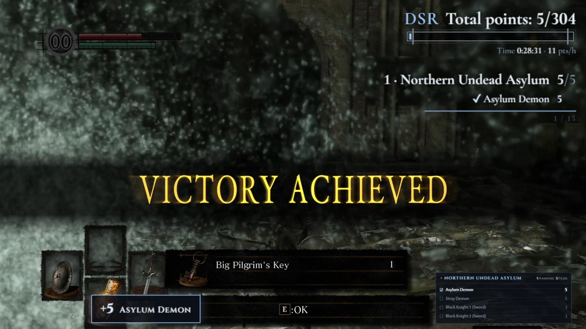
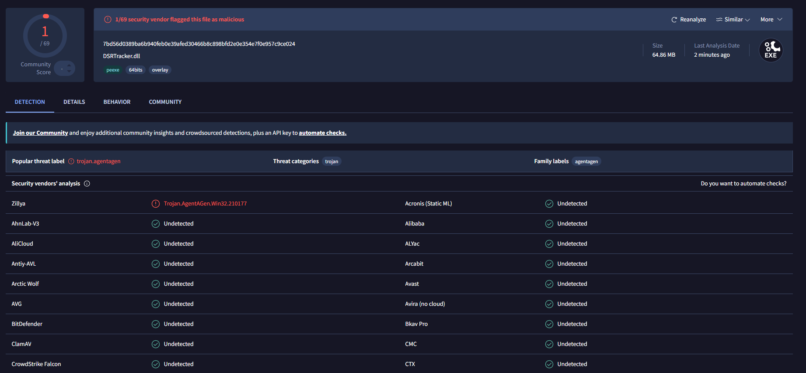
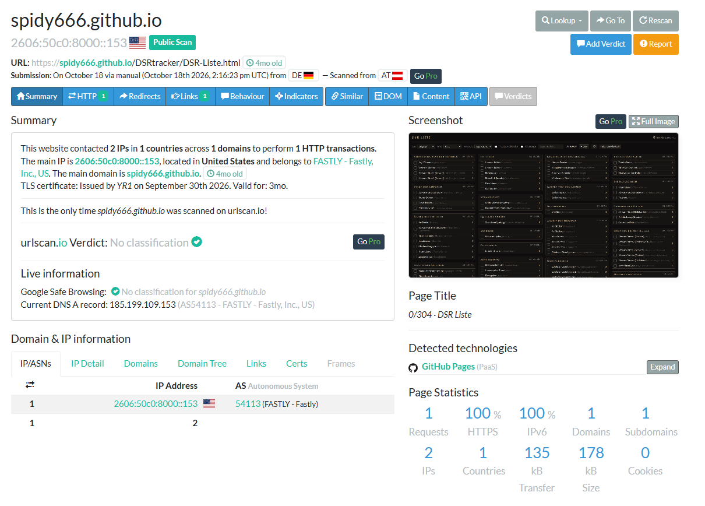
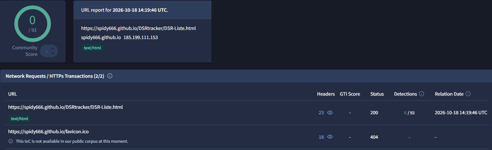

🇩🇪 [Deutsch](README.md) | 🇬🇧 **English**

> This is a translation of the German README. If the two differ, the German version applies.

# DSR Tracker

Shows on stream which bosses and minibosses from the points list have been defeated in **Dark Souls Remastered**, and adds up the points.

The tool only **reads** the game memory (event flags) and writes nothing to it.

## Three variants – which one fits?

| | **exe** (tracker) | **Web version** | **Offline list** |
|---|---|---|---|
| **Enemy detection** | automatic (72 of 84), the rest by click | checked off by hand | checked off by hand |
| **OBS overlays** | yes, all views | yes, all views | no |
| **Time** | real in-game time | run clock to start/pause | clock to start/pause |
| **Original / randomizer** | switchable | switchable | switchable |
| **Installation** | download and start the exe | none, just URLs in OBS | one HTML file, double-click |
| **Internet needed** | no | to load the page | no |
| **Get started** | [Release page](../../releases/latest) · [Verify](#download-and-verification-how-to-get-a-clean-exe) · [Usage](#usage) | [spidy666.github.io/DSRtracker](https://spidy666.github.io/DSRtracker/) · [More](#web-version-without-exe) · [Self-host](docs/WEBVERSION.en.md#self-hosting) | [DSR-Liste.html](https://spidy666.github.io/DSRtracker/DSR-Liste.html) · [Verify](#verifying-the-offline-list) |

All three use the same points list (26 areas, 84 enemies, 304 points; as randomizer list 90 enemies, 324 points). The following section and the security notes refer to the exe.

## What the tool does and doesn't do

**It does:**
- Open `DarkSoulsRemastered.exe` **for reading only** (`PROCESS_VM_READ | PROCESS_QUERY_LIMITED_INFORMATION`) and use `ReadProcessMemory` to read the kill flags, the in-game time and the player position.
- Start a small web server that is reachable **only on this computer** (`http://localhost:8765`), for the control page and the OBS overlay.
- Store manual checkmarks and settings in `%APPDATA%\DSRTracker\state.json`.

**It doesn't:**
- No writing to game memory (`WriteProcessMemory` does not appear in the code), no code or DLL injection, no changes to game files or save files.
- No administrator rights needed.
- No internet connections: no telemetry, no automatic updates, no remotely loaded scripts. Even the fonts are bundled locally.

The two places worth reading for a review: [`GameReader.cs`](GameReader.cs) (access to the game) and [`WebServer.cs`](WebServer.cs) (local web server). A part-by-part explanation of the whole code is in [docs/CODE.en.md](docs/CODE.en.md).

**Language:** The overlays can be shown in English (`lang=en`, or via the easy setup). The control page and the setup wizard are currently German only. The code comments are in German; [docs/CODE.en.md](docs/CODE.en.md) explains the code in English.

## Screenshots

The screenshots show the German interface.

In the real game: the Asylum Demon has just fallen, the tracker detected the kill by itself. Top right "Rotating areas" with total points and in-game time, bottom left the notification "+5 Asylum Demon", bottom right "Current area" with the enemy checked off.



"Rotating areas" overlay: total points with gap bar; below it the area changes every few seconds. Skipped enemies are marked red, the line at the bottom shows when the page changes.


"List" overlay: all areas with all enemies, total points and in-game time at the top.


| Compact | Next target | Current area |
|---|---|---|
|  |  |  |

Ticker for the edge of the screen:


Control page: check off enemies, build the overlay URL by clicking, splits and flag monitor.


Gap bar (`bar=gaps`): one segment per enemy in route order; skipped enemies remain visible as a reddish gap.


<details>
<summary>Overlay options, quick start, setup wizard and guide</summary>

Overlay options on the control page (only the options that apply to the selected view are shown):


Quick start in the setup wizard ("Bin überfordert, mach einfach!" = "I'm overwhelmed, just do it!"):


</details>

The screenshots from "Rotating areas" on show a simulated run (no game image; the overlay background is transparent in OBS).

## Download and verification: how to get a clean exe

The `DSRTracker.exe` on the [release page](../../releases/latest) is not uploaded by hand. It is built publicly by **GitHub Actions** from exactly this source code ([`release.yml`](.github/workflows/release.yml), log in the "Actions" tab). The following steps let you check that your exe is exactly that file and was not altered along the way.

### Step 1: Download only from the official release page

Download `DSRTracker.exe` and `DSRTracker.exe.sha256` **only** from https://github.com/spidy666/DSRtracker/releases, at the bottom under *Assets*. An exe that someone sends you via Discord, email or another website is not automatically the same file.

### Step 2: Compare the checksum (simple, no extra software)

Open a command prompt in the download folder (type `cmd` into the Explorer address bar, press Enter) and enter:

```
certutil -hashfile DSRTracker.exe SHA256
```

The displayed string must match the one in `DSRTracker.exe.sha256` **exactly** (open the file with a text editor). GitHub also shows the same checksum next to the file on the release page (`sha256:…`).

This shows that the file was not damaged or swapped during download. It does not show **who** built it. That is what step 3 is for.

### Step 3: Verify the provenance attestation (recommended)

Every release exe carries a **provenance attestation** (build provenance) signed by GitHub. It proves that the file was built by GitHub Actions in this repo, with which workflow and from which commit. Unlike a checksum, it cannot be forged together with the file.

1. Install the [GitHub CLI](https://cli.github.com/) once, e.g. with `winget install --id GitHub.cli`, then open a new window.
2. Sign in once: `gh auth login` (a free GitHub account is enough).
3. Verify in the download folder:

   ```
   gh attestation verify DSRTracker.exe --repo spidy666/DSRtracker
   ```

**Everything is fine** if the output looks like this:

```
Loaded 1 attestation from GitHub API
✓ Verification succeeded!
  - Build repo:..... spidy666/DSRtracker
  - Build workflow:. .github/workflows/release.yml@refs/tags/<version>
```

Make sure *Build repo* says exactly `spidy666/DSRtracker` and *Build workflow* says `release.yml` with the tag of the version you downloaded (e.g. `refs/tags/0.5.4`).

**Do not use the file** if you see `HTTP 404: Not Found` or `Verification failed` instead. Then the file does not come from a release build of this repo, for example because it was modified, renamed from another source, or built yourself. In that case download it again from the release page.

All attestations can also be viewed in the repo under [Attestations](../../attestations). **Note:** Attestations exist from version 0.5.2 onwards. For older versions only step 2 works.

### More convenient: `update.bat`

`update.bat` does steps 1 to 3 automatically. It is in the source code and, from version 0.5.3 onwards, attached to every release under *Assets*.

1. Put `update.bat` next to `DSRTracker.exe` (in the source folder it automatically updates `dist\DSRTracker.exe`).
2. Close the tracker, double-click `update.bat`.

The script shows every step: it asks GitHub for the latest release, downloads the exe from the official release page, checks the SHA256 checksum and, if the GitHub CLI is installed, the attestation. Only when everything matches does it replace the old exe; the old one is kept as `DSRTracker.exe.bak`. On any error it aborts without changing anything. If the exe is already up to date, nothing happens (`update.bat --force` downloads it anyway). At the end the window waits for a key press. The script's messages are in German.

The tracker itself still makes no internet connection. Only this script does, and only when you start it.

### Alternative: build it yourself

If you don't want to trust anyone, build the exe yourself from the source code (see ["Building"](#building-once)). A self-built exe has a different checksum than the release one because builds are not bit-identical, so it will not pass steps 2 and 3. That is normal: here the source code itself is the check.

From version 0.7.2 on, the exe is built without compression (about 65 MB), because a packed exe is falsely flagged as suspicious by more virus scanners. If you want a smaller file (about 35 MB), change the switch `-p:EnableCompressionInSingleFile=false` to `true` in `build.bat` and build it yourself.

### SmartScreen warning

The exe is not signed with a paid certificate, so Windows SmartScreen may warn on first launch. If steps 2 and 3 succeeded: "More info" → "Run anyway".

### VirusTotal

[Result for the exe of version 0.7.2](https://www.virustotal.com/gui/file/7bd56d0389ba6b940feb0e39afed30466b8c898bfd2e0e354e7f0e957c9ce024) (SHA256 `7bd56d03…9ce024`): **1 of 69** scanners flags it – Zillya ("Trojan.AgentAGen"). Microsoft, Kaspersky, ESET, Bitdefender, Avast, AVG, Malwarebytes, Sophos, Symantec and the rest report nothing.



For comparison: the exe of 0.7.1 was still packed with compression and got [3 of 71](https://www.virustotal.com/gui/file/db7e40c1850416ad5d77a0d0df117dc444c4b82c45d194137fa03f7da0e3184a). Since 0.7.2 it is built without compression (see [build it yourself](#alternative-build-it-yourself)).

What this is probably due to, and how to judge for yourself:

- The hit is a **generic label** ("AgentAGen" = generic agent) from a smaller scanner, not known malware with a name. Such false positives are common for unsigned .NET programs – all the more for one that accesses another process (read-only).
- **What the exe actually does** can be checked openly: the complete source code is here, the exe is built from it publicly by GitHub Actions, and the signed provenance attestation (step 3) proves that exactly this file comes from exactly this source. What it may and may not do is described under [Security](#security).
- If you still don't trust the exe: [build it yourself](#alternative-build-it-yourself) or use the [web version](#web-version-without-exe) without an exe.
- Every new version has a different checksum and needs its own scan. You can check any version yourself: upload the exe to virustotal.com and compare the checksum in the result with the `.sha256` from the release.

## Building (once)

1. Install the .NET SDK (8 or newer): https://dotnet.microsoft.com/download/dotnet/8.0
2. Double-click `build.bat`
3. Result: `dist\DSRTracker.exe` (self-contained, needs no installed .NET)

## Usage

1. Start `DSRTracker.exe` (before or after the game). On the **first start** a **setup wizard** opens (connection test, overlay selection, OBS setup with test notification), then the control page. If you don't want to configure much, click **"Bin überfordert, mach einfach!"** ("I'm overwhelmed, just do it!") and get the finished OBS links right away (English overlays). The wizard is always available at `http://localhost:8765/setup`.
2. In OBS: Source → **Browser** → URL `http://localhost:8765/overlay`
   - Options can be put together by clicking on the control page (columns, size, open enemies only, compact view …). For English names add `?lang=en`.
3. Play. Detected kills are checked off and shown automatically.

## Automatic vs. manual

- 72 of 84 enemies have a permanent kill flag in the save and are detected automatically.
- 12 enemies respawn and have no flag (Black Knights in the Kiln, Channelers + Golem in the Duke's Archives, Berenike Knights in Sen's Fortress and the Painted World, Titanite Demon in Lost Izalith). Check those off with a click on the control page.
- Any enemy can also be checked off manually, in case a flag doesn't trigger.

## Randomizer list

For a randomizer version of the game, the **enemy list** can be switched from "Original" to "Randomizer" on the control page ("Run" card). This applies immediately to all overlays, in the exe and in the web version; the header then reads "DSR Randomizer".

- Scoring is **by place**: every place keeps the original's flag and points, only the displayed name is that of the new enemy. Where the Taurus Demon used to be and a Gargoyle stands now, the Gargoyle counts 5 points – detected automatically through the Taurus Demon's flag. The tip in "Next target" names the original place.
- On top come **8 additional places** (mostly Mimics) worth 26 points together, and 2 places in the Kiln of the First Flame are dropped: 90 enemies, 324 points. No flag is known for the additional places, they are checked off by hand.
- Checkmarks and kills are kept when switching.
- The names follow the official list as of October 2026 with the corrections announced on stream. Whether the flags still trigger in the randomizer version has not been tested in the game yet.
- The guide still shows the original enemies.

## Web version without exe

For everyone who doesn't want to or can't run an exe: the web version shows the same overlays, runs entirely in OBS (control page as a dock) and needs no installation. Enemies are checked off **manually** there, and a run clock replaces the in-game time. Its interface is German.

- Hosted: **https://spidy666.github.io/DSRtracker/**
- Set up on your own web server: **[docs/WEBVERSION.en.md](docs/WEBVERSION.en.md)**
- **Just the list to check off, without OBS:** download [DSR-Liste.html](https://spidy666.github.io/DSRtracker/DSR-Liste.html) and open it in the browser. A single file, works without a server and without internet, with original and randomizer list, score and clock. Handy for following a run. Its interface is German.

### Verifying the offline list

From version 0.7.1 on, `DSR-Liste.html` is also attached to every release, with a checksum (`DSR-Liste.html.sha256`) and a provenance attestation signed by GitHub – like the exe. If you don't want to simply double-click the file:

- **Don't download at all:** open the same list directly in the browser: https://spidy666.github.io/DSRtracker/DSR-Liste.html
- **Compare the checksum:** `certutil -hashfile DSR-Liste.html SHA256` and compare with `DSR-Liste.html.sha256` from the release.
- **Verify the origin:** `gh attestation verify DSR-Liste.html -R spidy666/DSRtracker` – confirms the file was built by GitHub Actions from this repository.
- **Rebuild it yourself:** `python tools/build_liste.py` produces the very same file byte for byte from the source; compare checksums.
- **See what it loads:** open the file, F12 → "Network" tab, reload. Only the file itself and the embedded fonts (`data:`) appear, no internet address. In the "Console" tab the browser would report in red if the page tried to load something anyway. A security rule in the file (`Content-Security-Policy: default-src 'none'`, at the very top of the source, visible in any text editor) forbids the browser any outside connection anyway.
- **Have the online version checked from outside:** [urlscan.io](https://urlscan.io) opens an address and lists every server contacted. For https://spidy666.github.io/DSRtracker/DSR-Liste.html only `spidy666.github.io` shows up. A public scan from 2026-10-18: [urlscan.io result](https://urlscan.io/result/01a14f5e-eb18-7054-a636-3fe775f496bb/) – 1 request, 1 domain, no cookies, no flag by Google Safe Browsing.

  
- **VirusTotal:** [check of the online version](https://www.virustotal.com/gui/url/df67fa08e4e55b938e5c67d21f4148c254c9438b001ca887bc55726a91e75456) – 0 of 93 scanners flag it. The second request there (`favicon.ico`, 404) is made by the browser on its own to look for a tab icon; from 0.7.1 on the icon is embedded in the file, so this request disappears too.

  
- The file is plain HTML with JavaScript and only runs in the browser: it cannot read other files or install anything.

Control page of the web version as a dock in OBS: check off enemies, run clock, save state.


## Files

All data is stored in `%APPDATA%\DSRTracker` (with `--portable` next to the exe instead):

- `state.json` – manual checkmarks, recent kills, settings. An old state file next to the exe is imported once on first start.
- `dsr_enemies.json` – optional. The enemy list is built into the exe. If you want to use your own list, put it here. It is validated on load; if it is invalid, the tracker uses the built-in list.

## Command-line options

- `--port 8766` – different port
- `--no-browser` – don't open the control page automatically
- `--portable` – store data next to the exe instead of under `%APPDATA%`
- `--web <folder>` – load the HTML files from a folder instead of the built-in ones (for customizing without rebuilding)
- `--selftest` – checks the flag IDs of the enemy list

## Security

Since version 0.5.0 the tracker has been specifically hardened (details in the [CHANGELOG](CHANGELOG.en.md)).

**Local web server** ([`WebServer.cs`](WebServer.cs))
- Listens only on `localhost` (no administrator rights needed for that) and accepts only requests from the own computer.
- Checks the Host header (protection against DNS rebinding).
- No CORS permissions: other websites in the browser can neither read nor follow the state.
- Changing requests (check off, reset, area, setup) only via POST from the own page, verified via `Origin` and `Sec-Fetch-Site` (protection against CSRF). Everything else is rejected with 403.
- Content Security Policy: the pages load only their own content and may only be embedded by their own pages. Plus `X-Content-Type-Options: nosniff` and `Referrer-Policy: no-referrer`.
- Only fixed, predefined files are served. Paths from requests are never used for file access.

**Access to the game** ([`GameReader.cs`](GameReader.cs))
- Minimal rights: `PROCESS_VM_READ | PROCESS_QUERY_LIMITED_INFORMATION`, only `ReadProcessMemory`.
- Before reading, it checks that the process really is `DarkSoulsRemastered.exe`.
- The game version is detected via the SHA256 checksum of the exe (known: 1.03.1 Steam) and displayed. If the memory structures are not found, the tracker reports a probably unsupported version instead of reading wrong values.
- Read errors, a closed game or a save switch are handled; the tracker reconnects afterwards.

**Files**
- Data only in `%APPDATA%\DSRTracker` (or next to the exe with `--portable`).
- A custom enemy list is validated on load (structure, points, flag IDs, route entries) and ignored if invalid.

**No external connections**
- No telemetry, no automatic updates, no remotely loaded code. Fonts are bundled locally (SIL Open Font License, see `web/fonts`).

**Checks on GitHub**
- The project has no NuGet dependencies.
- On every push and pull request: build without warnings, self-test of the enemy list, `dotnet list package --vulnerable` ([`build.yml`](.github/workflows/build.yml)).
- **CodeQL** analysis for C# and JavaScript on every push, pull request and weekly ([`codeql.yml`](.github/workflows/codeql.yml)).
- **Dependabot**: dependency graph, security alerts and automatic security updates are enabled, plus monthly version updates for Actions and NuGet ([`dependabot.yml`](.github/dependabot.yml)).
- The **release exe** is built from source by GitHub Actions and published with a SHA256 checksum and a signed provenance attestation ([`release.yml`](.github/workflows/release.yml), see "Download and verification").

Please do **not** report security vulnerabilities as a public issue, but confidentially, see [`SECURITY.en.md`](SECURITY.en.md). Regular bugs are welcome as issues.

## Road to 1.0

The feature set is complete; a full run in the real game is still open. Which tests are missing is listed in [ROADMAP.en.md](ROADMAP.en.md). Once they pass, this becomes version 1.0.

Testing it yourself without beating every boss the regular way: the test tool DSR-Gadget works well for this (teleport to bonfires, invincibility, quick kills). How to do it and what to watch out for (offline only, don't set flags, back up your save) is in [ROADMAP.en.md – Tools for testing](ROADMAP.en.md#tools-for-testing).

## Origin

The tracker was developed with the help of AI (Claude by Anthropic). All code is openly visible, and that is exactly why a look at `GameReader.cs` and `WebServer.cs` is worthwhile.

## Data sources

Flag IDs from the DSR event scripts (extracted with Soulstruct). Memory signatures and flag addressing after JKAnderson (DSR-Gadget) and FrankvdStam (SoulMemory / SoulSplitter).

## License

Copyright (C) 2026 spidy666

This project is licensed under the **GNU General Public License v3.0** (see `LICENSE`).
It uses memory signatures and event flag addressing from
[SoulMemory / SoulSplitter](https://github.com/FrankvdStam/SoulSplitter) (GPL-3.0)
as well as findings from [DSR-Gadget](https://github.com/JKAnderson/DSR-Gadget).
