🇩🇪 **Deutsch** | 🇬🇧 [English](README.en.md)

# DSR Tracker

Zeigt im Stream an, welche Bosse und Minibosse der Punkteliste in **Dark Souls Remastered** besiegt sind, und rechnet die Punkte zusammen.

Das Tool **liest** den Spielspeicher nur (Event-Flags) und schreibt nichts hinein.

## Was das Tool tut und was nicht

**Es tut:**
- Es öffnet `DarkSoulsRemastered.exe` **nur zum Lesen** (`PROCESS_VM_READ | PROCESS_QUERY_LIMITED_INFORMATION`) und liest mit `ReadProcessMemory` die Kill-Flags, die Spielzeit und die Spielerposition.
- Es startet einen kleinen Webserver, der **nur auf diesem Rechner** erreichbar ist (`http://localhost:8765`), für Steuerseite und OBS-Overlay.
- Es speichert manuelle Haken und Einstellungen in `%APPDATA%\DSRTracker\state.json`.

**Es tut nicht:**
- Kein Schreiben in den Spielspeicher (`WriteProcessMemory` kommt im Code nicht vor), keine Code- oder DLL-Injection, keine Änderungen an Spieldateien oder Spielständen.
- Keine Administratorrechte nötig.
- Keine Verbindungen ins Internet: keine Telemetrie, keine automatischen Updates, keine nachgeladenen Skripte. Auch die Schriftarten werden lokal mitgeliefert.

Die beiden Stellen, die man zum Prüfen lesen sollte: [`GameReader.cs`](GameReader.cs) (Zugriff auf das Spiel) und [`WebServer.cs`](WebServer.cs) (lokaler Webserver). Eine Erklärung des gesamten Codes, Teil für Teil, steht in [docs/CODE.md](docs/CODE.md).

## Screenshots

Overlay „Wechselnde Gebiete“: Gesamtpunkte mit Lückenbalken, darunter wechselt alle paar Sekunden das Gebiet. Ausgelassene Gegner sind rot markiert, die Linie unten zeigt, wann die Seite wechselt.

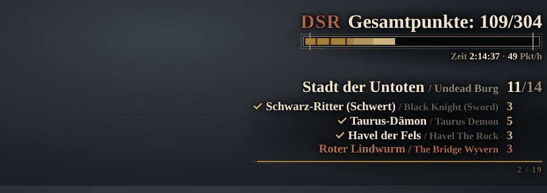

Overlay „Liste“: alle Gebiete mit allen Gegnern, oben die Gesamtpunkte mit Spielzeit.

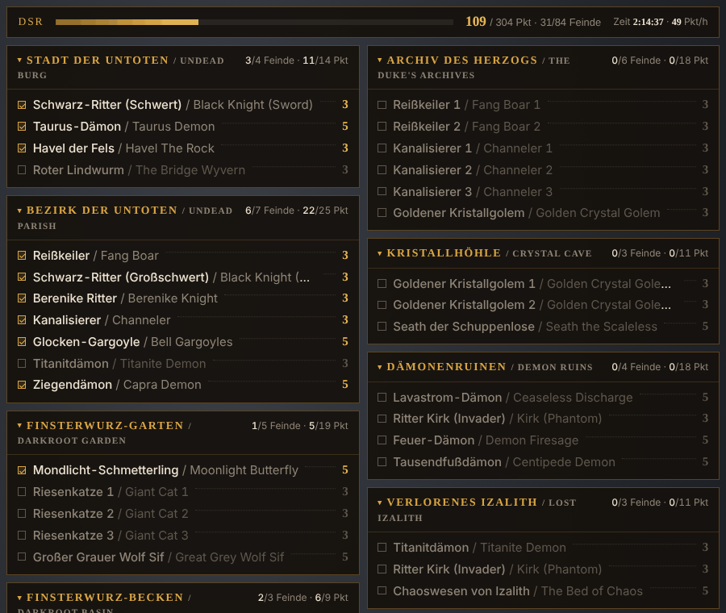

| Kompakt | Nächstes Ziel | Aktuelles Gebiet |
|---|---|---|
| 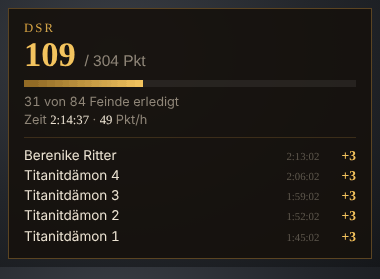 | 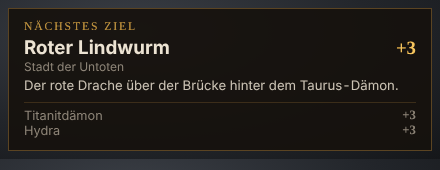 | 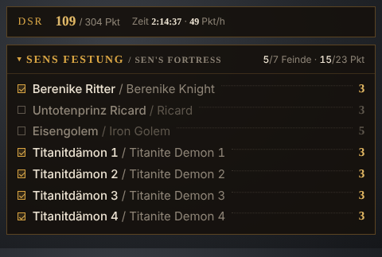 |

Laufband für den Bildschirmrand:

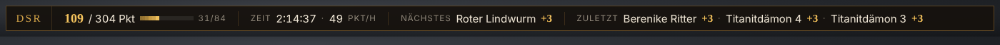

Steuerseite: Gegner abhaken, Overlay-URL zusammenklicken, Splits und Flag-Monitor.

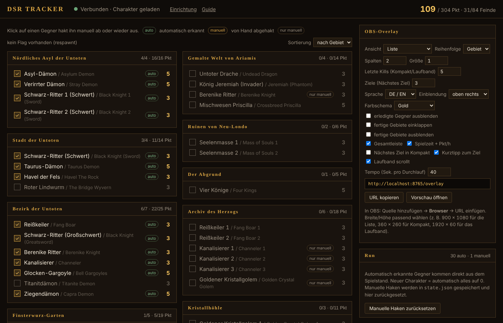

Lückenbalken (`bar=gaps`): ein Stück pro Gegner in Routen-Reihenfolge, ausgelassene Gegner bleiben als rötliche Lücke sichtbar.

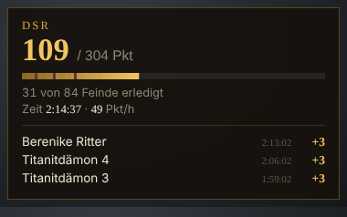

<details>
<summary>Overlay-Optionen, Schnellstart, Einrichtungsassistent und Guide</summary>

Overlay-Optionen der Steuerseite (es erscheinen nur die Optionen, die zur gewählten Ansicht passen):

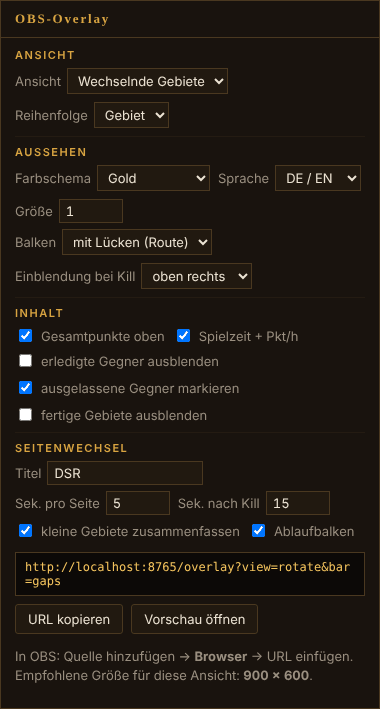

Schnellstart im Einrichtungsassistenten:

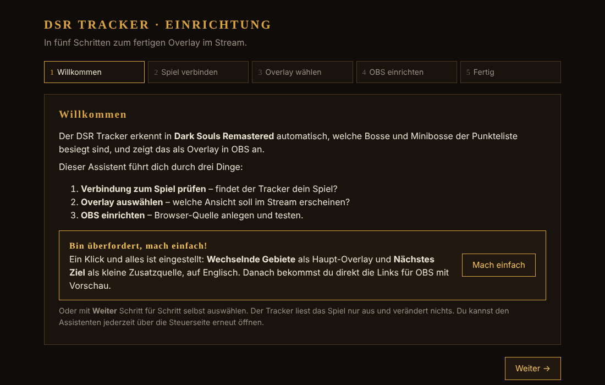

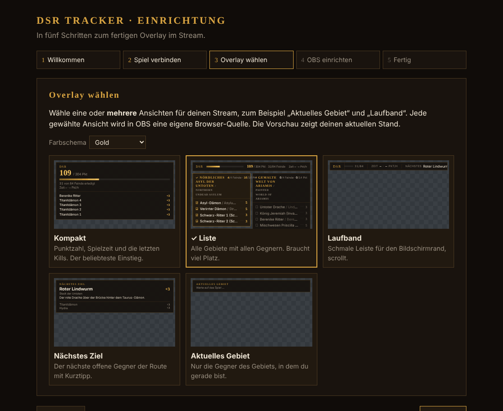

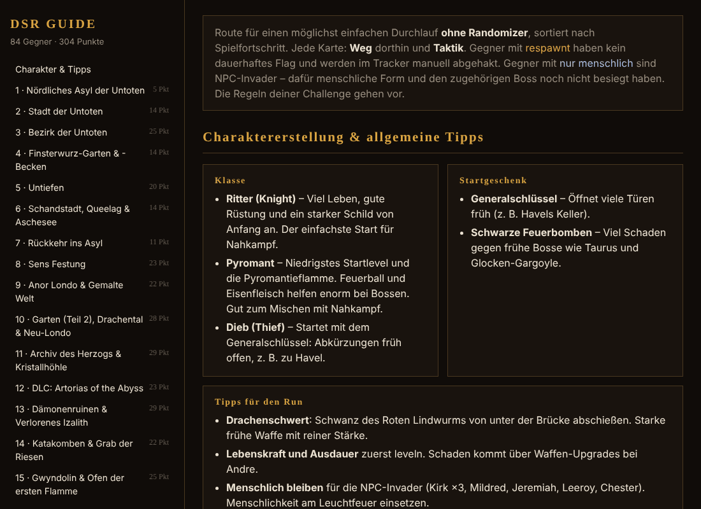

</details>

Die Screenshots zeigen einen nachgestellten Run (ohne Spielbild, der Overlay-Hintergrund ist in OBS durchsichtig).

## Download und Prüfung: So bekommst du eine saubere exe

Die `DSRTracker.exe` auf der [Release-Seite](../../releases/latest) wird nicht von Hand hochgeladen, sondern von **GitHub Actions** öffentlich aus genau diesem Quellcode gebaut ([`release.yml`](.github/workflows/release.yml), Protokoll im Reiter „Actions“). Mit den folgenden Schritten prüfst du, dass deine exe genau diese ist und unterwegs nicht verändert wurde.

### Schritt 1: Nur von der offiziellen Release-Seite laden

Lade `DSRTracker.exe` und `DSRTracker.exe.sha256` **nur** von https://github.com/spidy666/DSRtracker/releases herunter, unten bei *Assets*. Eine exe, die dir jemand per Discord, Mail oder von einer anderen Seite schickt, ist nicht automatisch dieselbe Datei.

### Schritt 2: Prüfsumme vergleichen (einfach, ohne Zusatzprogramm)

Im Download-Ordner eine Eingabeaufforderung öffnen (im Explorer in die Adresszeile `cmd` tippen, Enter) und eingeben:

```
certutil -hashfile DSRTracker.exe SHA256
```

Die angezeigte Zeichenfolge muss **exakt** mit der in `DSRTracker.exe.sha256` übereinstimmen (Datei mit dem Editor öffnen). Dieselbe Prüfsumme zeigt GitHub auch auf der Release-Seite neben der Datei an (`sha256:…`).

Das zeigt, dass die Datei beim Herunterladen nicht beschädigt oder ausgetauscht wurde. Es zeigt aber nicht, **wer** sie gebaut hat. Dafür gibt es Schritt 3.

### Schritt 3: Herkunftsnachweis prüfen (empfohlen)

Jede Release-exe trägt einen von GitHub signierten **Herkunftsnachweis** (Build-Provenance). Er belegt, dass die Datei von GitHub Actions in diesem Repo gebaut wurde, mit welchem Workflow und aus welchem Stand. Anders als eine Prüfsumme kann man ihn nicht zusammen mit der Datei fälschen.

1. Einmalig die [GitHub CLI](https://cli.github.com/) installieren, z. B. mit `winget install --id GitHub.cli`, danach ein neues Fenster öffnen.
2. Einmalig anmelden: `gh auth login` (ein kostenloses GitHub-Konto genügt).
3. Im Download-Ordner prüfen:

   ```
   gh attestation verify DSRTracker.exe --repo spidy666/DSRtracker
   ```

**Alles in Ordnung**, wenn die Ausgabe so aussieht:

```
Loaded 1 attestation from GitHub API
✓ Verification succeeded!
  - Build repo:..... spidy666/DSRtracker
  - Build workflow:. .github/workflows/release.yml@refs/tags/<Version>
```

Achte darauf, dass bei *Build repo* genau `spidy666/DSRtracker` steht und bei *Build workflow* `release.yml` mit dem Tag der Version, die du geladen hast (z. B. `refs/tags/0.5.4`).

**Nicht verwenden**, wenn stattdessen `HTTP 404: Not Found` oder `Verification failed` erscheint. Dann stammt die Datei nicht aus einem Release-Build dieses Repos, zum Beispiel weil sie verändert, umbenannt aus einer anderen Quelle oder selbst gebaut wurde. Lade sie in dem Fall neu von der Release-Seite.

Alle Nachweise sind auch im Repo unter [Attestations](../../attestations) einsehbar. **Hinweis:** Herkunftsnachweise gibt es ab Version 0.5.2. Für ältere Versionen funktioniert nur Schritt 2.

### Bequemer: `update.bat`

`update.bat` erledigt Schritt 1 bis 3 automatisch. Es liegt im Quellcode und ab Version 0.5.3 auch an jedem Release unter *Assets*.

1. `update.bat` neben die `DSRTracker.exe` legen (im Quellcode-Ordner aktualisiert es automatisch `dist\DSRTracker.exe`).
2. Tracker schließen, `update.bat` doppelklicken.

Das Skript zeigt jeden Schritt an: Es fragt den neuesten Release bei GitHub ab, lädt die exe von der offiziellen Release-Seite, prüft die SHA256-Prüfsumme und, wenn die GitHub CLI installiert ist, den Herkunftsnachweis. Erst wenn alles stimmt, ersetzt es die alte exe; die alte bleibt als `DSRTracker.exe.bak` erhalten. Bei jedem Fehler bricht es ab, ohne etwas zu verändern. Ist die exe schon aktuell, passiert nichts (`update.bat --force` lädt trotzdem neu). Am Ende wartet das Fenster auf einen Tastendruck.

Der Tracker selbst baut weiterhin keine Verbindung ins Internet auf. Nur dieses Skript tut das, und nur, wenn du es startest.

### Alternative: selbst bauen

Wer niemandem vertrauen will, baut die exe selbst aus dem Quellcode (siehe [„Bauen“](#bauen-einmalig)). Eine selbst gebaute exe hat eine andere Prüfsumme als die vom Release, weil Builds nicht bitgenau gleich sind, und besteht deshalb Schritt 2 und 3 nicht. Das ist normal: Hier ist der Quellcode selbst die Prüfung.

### SmartScreen-Warnung

Die exe ist nicht mit einem kostenpflichtigen Zertifikat signiert. Windows SmartScreen kann deshalb beim ersten Start warnen. Wenn Schritt 2 und 3 erfolgreich waren: „Weitere Informationen“ → „Trotzdem ausführen“.

## Bauen (einmalig)

1. .NET SDK installieren (8 oder neuer): https://dotnet.microsoft.com/download/dotnet/8.0
2. `build.bat` doppelklicken
3. Ergebnis: `dist\DSRTracker.exe` (eigenständig, braucht kein installiertes .NET)

## Benutzen

1. `DSRTracker.exe` starten (vor oder nach dem Spiel). Beim **ersten Start** öffnet sich ein **Einrichtungsassistent** (Verbindungstest, Overlay-Auswahl, OBS-Einrichtung mit Test-Einblendung), danach die Steuerseite. Wer nicht viel einstellen will, klickt dort auf **„Bin überfordert, mach einfach!“** und bekommt direkt die fertigen OBS-Links. Der Assistent ist jederzeit unter `http://localhost:8765/setup` erreichbar.
2. In OBS: Quelle → **Browser** → URL `http://localhost:8765/overlay`
   - Optionen lassen sich auf der Steuerseite zusammenklicken (Spalten, Größe, nur offene Gegner, Kompaktansicht …).
3. Spielen. Erkannte Kills werden automatisch abgehakt und eingeblendet.

## Automatisch vs. manuell

- 72 von 84 Gegnern haben ein dauerhaftes Kill-Flag im Spielstand und werden automatisch erkannt.
- 12 Gegner respawnen und haben kein Flag (Black Knights im Ofen, Kanalisierer + Golem im Archiv, Ritter von Berenike in Sens Festung und Gemalter Welt, Titanitdämon in Izalith). Die auf der Steuerseite per Klick abhaken.
- Jeder Gegner kann zusätzlich manuell abgehakt werden, falls ein Flag mal nicht auslöst.

## Randomizer-Liste

Für eine Randomizer-Version des Spiels lässt sich auf der Steuerseite (Karte „Run“) die **Gegnerliste** von „Original“ auf „Randomizer“ umstellen. Das gilt sofort für alle Overlays, in der exe wie in der Web-Version; oben steht dann „DSR Randomizer“.

- Gewertet wird **nach Platz**: Jeder Platz behält Flag und Punkte des Originals, nur der angezeigte Name ist der des neuen Gegners. Wo im Original der Taurus-Dämon stand und jetzt ein Gargoyle, zählt der Gargoyle mit 5 Punkten – automatisch erkannt über das Flag des Taurus-Dämons. Der Tipp im „Nächsten Ziel“ nennt den Originalplatz.
- Dazu kommen **8 zusätzliche Plätze** (vor allem Mimics) mit zusammen 26 Punkten, und 2 Plätze im Ofen der Ersten Flamme fallen weg: 90 Gegner, 324 Punkte. Für die Zusatzplätze ist kein Flag bekannt, sie werden von Hand abgehakt.
- Haken und Kills bleiben beim Umschalten erhalten.
- Die Namen entsprechen dem Stand der offiziellen Liste vom Oktober 2026 mit den im Stream angekündigten Korrekturen. Ob die Flags in der Randomizer-Version weiter ausgelöst werden, ist noch nicht im Spiel getestet.
- Der Guide zeigt weiterhin die Originalgegner.

## Web-Version ohne exe

Für alle, die keine exe ausführen wollen oder können: Die Web-Version zeigt dieselben Overlays, läuft komplett in OBS (Steuerseite als Dock) und braucht keine Installation. Gegner werden dort **von Hand** abgehakt, statt der Spielzeit gibt es eine Run-Uhr.

- Fertig gehostet: **https://spidy666.github.io/DSRtracker/**
- Auf einem eigenen Webserver einrichten: **[docs/WEBVERSION.md](docs/WEBVERSION.md)**
- **Nur die Liste zum Abhaken, ohne OBS:** [DSR-Liste.html](https://spidy666.github.io/DSRtracker/DSR-Liste.html) herunterladen und im Browser öffnen. Eine einzelne Datei, läuft ohne Server und ohne Internet, mit Original- und Randomizer-Liste, Punktestand und Uhr. Gut zum Mitverfolgen eines Runs.

Steuerseite der Web-Version als Dock in OBS: Gegner abhaken, Run-Uhr, Stand sichern.

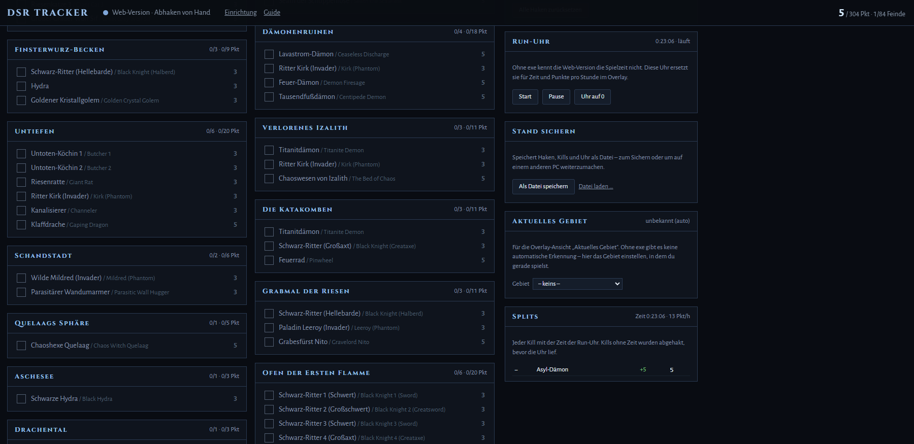

## Dateien

Alle Daten liegen in `%APPDATA%\DSRTracker` (mit `--portable` stattdessen neben der exe):

- `state.json` – manuelle Haken, letzte Kills, Einstellungen. Ein alter Stand neben der exe wird beim ersten Start einmalig übernommen.
- `dsr_enemies.json` – optional. Die Gegnerliste ist in die exe eingebaut. Wer eine eigene Liste nutzen will, legt sie hier ab. Sie wird beim Laden geprüft; ist sie fehlerhaft, nutzt der Tracker die eingebaute Liste.

## Startoptionen

- `--port 8766` – anderer Port
- `--no-browser` – Steuerseite nicht automatisch öffnen
- `--portable` – Daten neben der exe speichern statt unter `%APPDATA%`
- `--web <ordner>` – HTML-Dateien aus einem Ordner laden statt der eingebauten (zum Anpassen ohne Neu-Bauen)
- `--selftest` – prüft die Flag-IDs der Gegnerliste

## Sicherheit

Seit Version 0.5.0 ist der Tracker gezielt abgesichert (Details im [CHANGELOG](CHANGELOG.md)).

**Lokaler Webserver** ([`WebServer.cs`](WebServer.cs))
- Lauscht nur auf `localhost` (braucht dafür keine Administratorrechte) und nimmt nur Anfragen vom eigenen Rechner an.
- Prüft den Host-Header (Schutz gegen DNS-Rebinding).
- Keine CORS-Freigaben: Andere Webseiten im Browser können den Stand weder lesen noch mitlesen.
- Ändernde Anfragen (Abhaken, Reset, Gebiet, Einrichtung) nur per POST von der eigenen Seite, geprüft über `Origin` und `Sec-Fetch-Site` (Schutz gegen CSRF). Alles andere wird mit 403 abgewiesen.
- Content-Security-Policy: Die Seiten laden nur eigene Inhalte und dürfen nur von eigenen Seiten eingebettet werden. Dazu `X-Content-Type-Options: nosniff` und `Referrer-Policy: no-referrer`.
- Ausgeliefert werden nur fest eingetragene Dateien. Pfade aus Anfragen werden nie für Dateizugriffe verwendet.

**Zugriff auf das Spiel** ([`GameReader.cs`](GameReader.cs))
- Minimale Rechte: `PROCESS_VM_READ | PROCESS_QUERY_LIMITED_INFORMATION`, nur `ReadProcessMemory`.
- Vor dem Lesen wird geprüft, dass der Prozess wirklich `DarkSoulsRemastered.exe` ist.
- Die Spielversion wird über die SHA256-Prüfsumme der exe erkannt (bekannt: 1.03.1 Steam) und angezeigt. Werden die Speicherstrukturen nicht gefunden, meldet der Tracker eine vermutlich nicht unterstützte Version statt falsche Werte zu lesen.
- Lesefehler, ein beendetes Spiel oder ein Spielstand-Wechsel werden abgefangen, der Tracker verbindet sich danach neu.

**Dateien**
- Daten nur in `%APPDATA%\DSRTracker` (bzw. neben der exe mit `--portable`).
- Eine eigene Gegnerliste wird beim Laden geprüft (Struktur, Punkte, Flag-IDs, Routen-Einträge) und bei Fehlern ignoriert.

**Keine externen Verbindungen**
- Keine Telemetrie, keine automatischen Updates, kein Nachladen von Code. Schriftarten liegen lokal bei (SIL Open Font License, siehe `web/fonts`).

**Prüfung auf GitHub**
- Das Projekt hat keine NuGet-Abhängigkeiten.
- Bei jedem Push und Pull Request: Build ohne Warnungen, Selbsttest der Gegnerliste, `dotnet list package --vulnerable` ([`build.yml`](.github/workflows/build.yml)).
- **CodeQL**-Analyse für C# und JavaScript bei jedem Push, Pull Request und wöchentlich ([`codeql.yml`](.github/workflows/codeql.yml)).
- **Dependabot**: Abhängigkeitsgraph, Sicherheitswarnungen und automatische Sicherheits-Updates sind aktiv, dazu monatliche Versions-Updates für Actions und NuGet ([`dependabot.yml`](.github/dependabot.yml)).
- **Release-exe** wird von GitHub Actions aus dem Quellcode gebaut und mit SHA256-Prüfsumme und signiertem Herkunftsnachweis veröffentlicht ([`release.yml`](.github/workflows/release.yml), siehe „Download und Prüfung“).

Sicherheitslücken bitte **nicht** als öffentliches Issue melden, sondern vertraulich, siehe [`SECURITY.md`](SECURITY.md). Normale Fehler gerne als Issue.

## Weg zu 1.0

Der Funktionsumfang ist komplett, offen ist noch ein vollständiger Run im echten Spiel. Welche Tests noch fehlen, steht in [ROADMAP.md](ROADMAP.md). Laufen sie sauber durch, wird daraus Version 1.0.

Selbst testen ohne jeden Boss regulär zu besiegen: Dafür eignet sich das Testwerkzeug DSR-Gadget (Teleport zu Leuchtfeuern, Unsterblichkeit, schnelle Kills). Wie das geht und worauf du achten musst (nur offline, keine Flags setzen, Spielstand sichern), steht in [ROADMAP.md – Hilfsmittel zum Testen](ROADMAP.md#hilfsmittel-zum-testen).

## Entstehung

Der Tracker wurde mit Unterstützung von KI (Claude von Anthropic) entwickelt. Der gesamte Code ist offen einsehbar, und gerade deshalb lohnt sich ein Blick in `GameReader.cs` und `WebServer.cs`.

## Herkunft der Daten

Flag-IDs aus den Event-Skripten von DSR (ausgelesen mit Soulstruct). Speicher-Signaturen und Flag-Adressierung nach JKAnderson (DSR-Gadget) und FrankvdStam (SoulMemory / SoulSplitter).

## Lizenz

Copyright (C) 2026 spidy666

Dieses Projekt steht unter der **GNU General Public License v3.0** (siehe `LICENSE`).
Es verwendet Speicher-Signaturen und die Event-Flag-Adressierung aus
[SoulMemory / SoulSplitter](https://github.com/FrankvdStam/SoulSplitter) (GPL-3.0)
sowie Erkenntnisse aus [DSR-Gadget](https://github.com/JKAnderson/DSR-Gadget).
