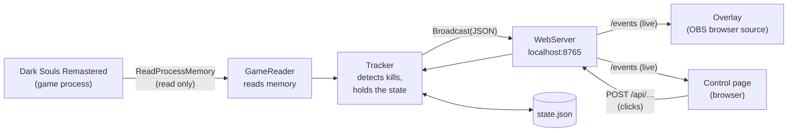

🇩🇪 [Deutsch](CODE.md) | 🇬🇧 **English**

> This is a translation of the German code documentation. If the two differ, the German version applies.

# The code explained

This document walks through the DSR Tracker part by part: what each file does, how the parts work together and why things are solved the way they are. It is meant for anyone who wants to review, understand or change the code. Programming knowledge helps but isn't needed for every section.

The source files themselves are commented in detail as well, **in German**. This document gives the overview in English; the comments give the details in place.

**Contents**

1. [The big picture](#1-the-big-picture)
2. [Files at a glance](#2-files-at-a-glance)
3. [Program.cs – entry point](#3-programcs--entry-point)
4. [GameReader.cs – access to the game](#4-gamereadercs--access-to-the-game)
5. [Tracker.cs – kill detection and state](#5-trackercs--kill-detection-and-state)
6. [WebServer.cs – local web server](#6-webservercs--local-web-server)
7. [Messages between tracker and pages](#7-messages-between-tracker-and-pages)
8. [dsr_enemies.json – the enemy list](#8-dsr_enemiesjson--the-enemy-list)
9. [overlay.html – the OBS overlay](#9-overlayhtml--the-obs-overlay)
10. [control.html – the control page](#10-controlhtml--the-control-page)
11. [setup.html – the setup wizard](#11-setuphtml--the-setup-wizard)
12. [Helper files: batch scripts, guide, fonts](#12-helper-files-batch-scripts-guide-fonts)
13. [GitHub: workflows and security](#13-github-workflows-and-security)
14. [Typical changes – where to look?](#14-typical-changes--where-to-look)
15. [Web version without exe](#15-web-version-without-exe)

---

## 1. The big picture



In words:

1. **GameReader** opens the game for reading only and reads the *event flags* every 0.5 seconds. That is a large memory block in which the game sets a bit for thousands of things, for example "boss X defeated" or "door Y opened". It also reads the in-game time and the player position.
2. **Tracker** compares the flags with the enemy list. If a flag of an enemy is newly set, the enemy is defeated. The tracker also manages manual checkmarks and stores them in `state.json`.
3. On every change the tracker sends the complete state as JSON to the **WebServer**, which immediately forwards it to all open pages, i.e. the overlay and the control page.
4. The **pages** redraw themselves from it. Clicks on the control page go back to the web server as POST requests and from there to the tracker.

Everything runs on the own computer. There is no connection to the internet.

---

## 2. Files at a glance

| File | Purpose |
|---|---|
| `Program.cs` | entry point: options, data folder, load enemy list, start everything |
| `GameReader.cs` | find the game, read memory, search signatures, convert flag numbers |
| `Tracker.cs` | data classes of the enemy list, kill detection, state, `state.json` |
| `WebServer.cs` | local HTTP server with security checks, live data stream |
| `DSRTracker.csproj` | project file: version, which files are built into the exe |
| `dsr_enemies.json` | enemy list: areas, enemies, points, flags, route, zone map |
| `web/overlay.html` | the OBS overlay, all views in one file |
| `web/control.html` | control page: list, overlay settings, splits, flag monitor |
| `web/setup.html` | setup wizard on first start |
| `web/fonts/` | bundled fonts (SIL Open Font License) and `fonts.css` |
| `guide.html` | guide (route, tips), also works without the tracker |
| `build.bat` | builds `dist\DSRTracker.exe` |
| `update.bat` | downloads the latest verified exe from GitHub |
| `start_mit_web_ordner.bat` | starts the tracker with the HTML files from `web\` instead of the built-in ones |
| `guide.bat` | opens the guide in the browser |
| `pages/`, `tools/build_pages.py` | web version without exe, see [section 15](#15-web-version-without-exe) |
| `README.md`, `CHANGELOG.md`, `SECURITY.md`, `docs/*.md` | documentation, each also as `.en.md` |
| `ROADMAP.md` | open tests until version 1.0 |
| `WICHTIG_LIES_MICH.txt` | short German overview for anyone who gets the source code as a ZIP |
| `.github/workflows/*.yml` | automatic checks and release build on GitHub |

The HTML pages, the fonts, the enemy list and the guide are **built into the exe** (`EmbeddedResource` in the `.csproj`). This makes the exe a single file that needs nothing next to it.

---

## 3. Program.cs – entry point

`Program.cs` has no `Main` method but uses *top-level statements*: the code runs from top to bottom.

1. **Parse options:**

   | Option | Effect |
   |---|---|
   | `--port 8766` | different port (only 1024–65535) |
   | `--no-browser` | don't open the browser automatically |
   | `--portable` | data next to the exe instead of in `%APPDATA%\DSRTracker` |
   | `--web <folder>` | load HTML pages from a folder, for customizing without rebuilding |
   | `--selftest` | check the flag conversion and exit |

2. **Data folder**: determine and create it. An old `state.json` next to the exe from earlier versions is imported once.
3. **Enemy list**: the built-in list is the default. If a custom `dsr_enemies.json` is in the data folder and passes validation (`EnemyFile.Parse`), it is used; otherwise there is a warning.
4. **Self-test** (only with `--selftest`): every flag ID is converted to a memory position and back. If it doesn't come back as the same ID, something is wrong. The test also runs automatically on GitHub.
5. **Start tracker and web server.** If the port is taken, for example because the tracker is already running, there is an understandable message.
6. **Console**: version, number of enemies and points, all addresses. Then the browser opens: the wizard on first start, the control page afterwards.
7. **Main loop** `tracker.Run()` runs until the window is closed or Ctrl+C is pressed.

---

## 4. GameReader.cs – access to the game

This is the only file that talks to the game, and the most important one for a security review.

### Connecting (`EnsureAttached`)

Called on every cycle, but searches at most every 2 seconds:

1. Look for the process `DarkSoulsRemastered`.
2. Check that the file name really is `DarkSoulsRemastered.exe`.
3. **Detect the version:** compute the SHA256 checksum of the exe file and compare it with known builds. The file version of the DSR exe is always "1.0.0.0" and doesn't help. The result is cached because the file is about 50 MB.
4. **Open the process** with exactly two rights: `PROCESS_VM_READ` (read memory) and `PROCESS_QUERY_LIMITED_INFORMATION`. A write right is never requested.
5. **Search signatures** (see below). Right after the game starts this can still fail; then it is retried. If it still fails after 15 attempts, the status points to a probably unsupported game version.

### Signatures (AOB scan)

The game data is at different addresses on every start. Only the game's **program code** is fixed. It contains instructions such as

```
48 8B 0D xx xx xx xx    mov rcx, [rip + xxxxxxxx]
```

which load a global pointer. The tracker reads the program code once (`ReadModuleImage`), searches for the byte pattern (`FindPattern`, `?` = any byte) and computes the address of the global pointer from the offset `xxxxxxxx` (`ScanRelative`):

```
target address = address of the instruction + length of the instruction (7) + offset
```

There are three signatures:

| Name | used for |
|---|---|
| `EventFlags` | event flags, i.e. who is defeated (required) |
| `WorldChrMan` | characters in the world: character loaded? position? (required) |
| `GameDataMan` | in-game time (optional) |

The patterns and offsets come from public community research (DSR-Gadget, SoulMemory).

### Pointer chains

From a global pointer, fixed offsets lead further, for example for the position:

```
WorldChrMan → +0x68 PlayerIns → +0x68 controller → +0x28 position object → +0x10 X, Y, Z (4-byte float each)
```

If a pointer along the way is 0, the object isn't there right now (main menu, loading screen). Then the function returns `null`.

| Function | reads |
|---|---|
| `IsPlayerLoaded()` | whether `PlayerIns` exists |
| `ReadPlayerPosition()` | X, Y, Z |
| `ReadIgtMs()` | in-game time in ms (GameDataMan + 0xA4) |
| `ReadFlagBlock()` | the whole flag block, about 91 KB |

### Event flags (`EventFlags`)

A flag ID has 8 digits: **G AAA S NNN**

| Part | Meaning | Conversion |
|---|---|---|
| G | group (0, 1, 5, 6, 7) | start position of the group in the block |
| AAA | area code (000, 100, 101 …) | index in the area list × 0x500 bytes |
| S | section 0–9 | × 128 bytes |
| NNN | number 0–999 | (NNN / 32) × 4 bytes, bit NNN % 32 |

**Example: Taurus Demon, flag 11010901**

| | Value | Bytes |
|---|---|---|
| Group 1 | start | 0x500 |
| Area 101 | index 2 → 2 × 0x500 | 0xA00 |
| Section 0 | 0 × 128 | 0 |
| Number 901 | 901 / 32 = 28 → 28 × 4 | 0x70 |
| **Position** | | **0xF70** |
| Bit | 901 % 32 = 5 → mask `0x80000000 >> 5` | `0x04000000` |

So the tracker reads the 4-byte word at position 0xF70 in the flag block and checks whether bit `0x04000000` is set.

`FromPosition` does the whole thing backwards (position + bit → flag ID). The flag monitor needs this to show changed bits as readable numbers.

### What is deliberately missing

No `WriteProcessMemory`, no `VirtualAllocEx`, no `CreateRemoteThread`, no DLL. Exactly three functions are imported from `kernel32.dll`: `OpenProcess`, `ReadProcessMemory` and `CloseHandle`.

---

## 5. Tracker.cs – kill detection and state

### Data classes

| Class | Content |
|---|---|
| `EnemyDef` | one enemy: names DE/EN, points, flags, tip |
| `AreaDef` | one area with enemies |
| `RouteDef` | one route chapter: title + enemy keys in play order |
| `EnemyFile` | the whole list + `Parse()` for validation |
| `RecentKill` | one "recent kills" entry: name, points, clock time, in-game time |
| `SavedState` | content of `state.json` |

An enemy's **key** is `"areaIndex-enemyIndex"`, for example `"0-0"` for the first enemy in the first area. The control page and the overlay use the same keys.

**`EnemyFile.Parse`** validates a list before it is used:
- Areas and names exist, names are at most 120 characters long.
- Points are between 0 and 100.
- Every flag can be converted.
- Every route key exists.
- Zone entries have 4 values and refer to an existing area.

### The loop (`Run` → `Poll`)

A `Poll()` runs every 0.5 seconds:

1. **Connect.** If that fails, everything is reset and retried next time.
2. **Character loaded?** In the menu or on the loading screen the data isn't reliable, so nothing is evaluated then.
3. **In-game time:** read it and send it about once per second as a `time` message, with the position.
4. **Estimate the area:** find the nearest point of the zone map (`NearestZone`).
5. **Read the flag block.**
6. **Flag monitor:** compare the old and new block word by word. Every changed bit is logged with its flag ID and, if known, the enemy name.
7. **Detect kills:** an enemy counts as defeated if **at least one** of its flags is set. Some enemies have several possible flags.
8. **Report:** new kills go to the console and as a `kill` message to the pages (notification). Then the new state is sent.

### Rules against false alarms

- **First read after loading:** everything is "new" here. So notifications only start from the second read (`_hadFirstRead`).
- **More than 3 new kills at once** almost always means a different save was loaded. Then there are no notifications (`newKills.Count > 3`).
- **A flag disappears**, e.g. because a different character was loaded: the enemy is no longer automatically done, and the recent kills list is adjusted.

### Automatic and manual

| | `_autoDone` | `_manualDone` |
|---|---|---|
| Source | flag in the save | click on the control page |
| saved | no, always comes from the game | yes, in `state.json` |
| reset | load a different save | "Reset manual checkmarks" |

An enemy counts as done if it is in either set. 12 enemies respawn and have no permanent flag. They can only be checked off manually.

### State (`GetStateJson`)

The complete state as JSON, see [section 7](#7-messages-between-tracker-and-pages). It is sent to all pages on every change.

### Concurrency

The tracker loop and the web server (clicks) run in different threads. Everything both touch is changed under `lock (_lock)`. Messages are sent outside the lock so that a slow page doesn't hold up the tracker.

---

## 6. WebServer.cs – local web server

Based on `HttpListener` from .NET and listens only on `http://localhost:8765/`. That way it needs no administrator rights.

### Addresses

| Method | Path | Effect |
|---|---|---|
| GET | `/`, `/control` | control page |
| GET | `/setup` | setup wizard |
| GET | `/guide` | guide |
| GET | `/overlay` | overlay (options in the URL) |
| GET | `/fonts/…`, `/web/fonts/…` | fonts, only names like `name.woff2/.css/.txt` |
| GET | `/events` | live data stream (Server-Sent Events) |
| GET | `/api/state` | state once as JSON |
| POST | `/api/toggle?key=0-0` | toggle a manual checkmark |
| POST | `/api/area?idx=3` | set the area (-2 = automatic) |
| POST | `/api/variant?v=rando` | switch the enemy list (`original` / `rando`) |
| POST | `/api/reset` | reset manual checkmarks |
| POST | `/api/clearlog` | clear the flag monitor |
| POST | `/api/test-toast` | test notification |
| POST | `/api/onboarding-done?done=1` | wizard completed |
| GET | `/favicon.ico` | empty response (204) so the browser doesn't complain |

Everything else returns 404. File names **never** come from the request; they are fixed in the code. Path tricks like `../` are therefore impossible.

### Security checks (on every request)

1. **Only from the own computer:** the sender address must be a loopback address.
2. **Host header** must be `localhost`, `127.0.0.1` or `[::1]` with our port. This protects against *DNS rebinding*: a foreign website suddenly points its domain to 127.0.0.1 and could otherwise query the tracker.
3. **POST only from our own pages:** a foreign `Origin` or `Sec-Fetch-Site: cross-site` is rejected. This protects against *CSRF*: a foreign website sends clicks to localhost in the background.

Plus security headers on all responses (`AddSecurityHeaders`):
- `Content-Security-Policy`: scripts, styles, fonts and connections only from the own server; embedding only by own pages.
- `X-Content-Type-Options: nosniff`
- `Referrer-Policy: no-referrer`

### Live data stream (`/events`)

*Server-Sent Events* are an HTTP response that stays open; the server keeps writing lines into it:

```
retry: 2000

data: {"type":"state", …}

data: {"type":"kill","key":"0-0","de":"Asyl-Dämon","en":"Asylum Demon","pts":5}
```

- `retry: 2000`: if the connection breaks, the browser reconnects by itself after 2 seconds.
- Right after connecting, the current state is sent.
- Every 15 seconds a comment line `: ping` is sent. It keeps the connection open and removes closed pages from the list.

---

## 7. Messages between tracker and pages

Three kinds of messages come via `/events`:

**`state`** – the complete state, on every change:

| Field | Meaning |
|---|---|
| `connected`, `playerLoaded`, `status`, `gameVersion` | connection to the game |
| `total`, `maxTotal`, `done`, `count` | points and number of enemies overall |
| `areas[]` | areas with `de`, `en`, `done`, `count`, `pts`, `maxPts`, `enemies[]` |
| `areas[].enemies[]` | `key`, `de`, `en`, `pts`, `done`, `auto`, `manual`, `tip`, `tracked` (has flags) |
| `igt` | in-game time in ms (or `null`) |
| `currentArea`, `areaAuto`, `autoArea`, `pos` | area (-2 unknown, -1 Firelink Shrine) and position |
| `route[]` | chapters: `title`, `titleEn`, `keys[]` |
| `recentKills[]` | recent kills, newest first |
| `flagLog[]` | flag monitor (at most 60 entries) |
| `onboardingDone` | wizard completed? |

**`time`** – about every second: `igt` and `pos`. The pages then only update the time display.

**`kill`** – a new kill: `key`, `de`, `en`, `pts`. Triggers the notification. With `key = "test"` it is the test notification from the wizard.

---

## 8. dsr_enemies.json – the enemy list

```json
{
  "areas": [
    { "de": "Nördliches Asyl der Untoten", "en": "Northern Undead Asylum",
      "enemies": [
        { "de": "Asyl-Dämon", "en": "Asylum Demon", "pts": 5, "flags": [16], "tip": "…" }
      ] }
  ],
  "route": [
    { "title": "2 · Stadt der Untoten", "titleEn": "2 · Undead Burg", "keys": ["1-0", "1-1", "1-3", "1-2"] }
  ],
  "zones": [ [275.1, -3.5, -99.5, 3], … ]
}
```

| Part | Content |
|---|---|
| `areas` | 26 areas, 84 enemies. Empty `flags` = manual only (respawns). `manual: true` marks these cases for documentation. |
| `route` | 15 chapters in play order, from the guide. Basis for "by route", "Next target", the gap bar and skipped enemies. |
| `zones` | about 2,100 points `[x, y, z, areaIndex]`. The area is that of the nearest point; -1 = Firelink Shrine. |

The names come from the German and English game texts, the points from the points list. The tips (`tip`) are German only.

**Randomizer variant (`randomizer`, optional):**

```json
"randomizer": {
  "title": "Randomizer",
  "names": { "1-1": ["Gargoyle", "Gargoyle"], … },
  "extra": [ { "area": 11, "after": "11-0", "de": "Mimic", "en": "Mimic", "pts": 3, "tip": "…" } ]
}
```

- `names`: new name `[de, en]` per place. Flags and points stay those of the original place, the tip becomes "Platz von &lt;original&gt;: …".
- `remove`: places that don't exist in the randomizer version (e.g. `21-1`); they are missing there from the list and the route.
- `extra`: additional places without a flag (checked off by hand). They get the keys "area-(count+n)", e.g. `11-3` to `11-6` in Anor Londo, and are placed after `after` in the list and the route.
- `ListView.Build` (in `Tracker.cs`) builds the "original" or "rando" view from this; `Tracker.SetVariant` switches (`POST /api/variant?v=rando`), saved as `variant` in `state.json`. The keys of the original places are the same in both views, so checkmarks are kept. The web version does the same in `view()` in `pages/local-backend.js`.
- The state additionally contains `variant` and `variantTitle`; the overlays then append "Randomizer" to "DSR".

---

## 9. overlay.html – the OBS overlay

A single page for all views. Which view and which options are in the URL, for example `/overlay?view=rotate&lang=en&theme=mond`.

### Structure

1. **`<style>`**: colors as CSS variables (`--gold`, `--panel` …). The color schemes only override these variables (`:root[data-theme="mond"]`). Then one section per view.
2. **Options** (`opt`): read from the URL, with defaults.
3. **Helper functions**: grouping, names, bar, time.
4. **Views**: one `render…` function each, which rebuilds the complete HTML.
5. **Connection** (`connect`): `state` → redraw, `time` → only time, `kill` → notification.

### Views

| `view=` | Function | Content |
|---|---|---|
| `full` (default) | `renderFull` | all areas in columns ("List") |
| `compact` | `renderCompact` | points, bar, recent kills |
| `next` | `renderNext` | next open enemies of the route |
| `area` | `renderArea` | only the current area |
| `ticker` | `renderTicker` | narrow ticker |
| `rotate` | `renderRotate` | rotating areas |

### Important options

| Option | Effect |
|---|---|
| `order=route` | by route chapter instead of by area |
| `lang=de/en/both` | language of the names |
| `theme=glut/mond/abgrund` | color scheme (Ash & Ember / Moonlight / Abyss) |
| `scale=1.5` | size |
| `bar=gaps` | bar with one segment per enemy in route order |
| `hideDone=1`, `hideCleared=1`, `collapseCleared=1` | hide or collapse completed items |
| `missed=0` | don't mark skipped enemies red |
| `toast=0`, `toastPos=bottom-left` | notification off or in another corner |
| `time=0`, `total=0` | time or total line off |
| `interval`, `hold`, `merge`, `timer`, `shade`, `title` | only for `rotate`, see below |

The full list is commented at the beginning of the script. The control page puts the URL together by clicking.

### Individual mechanics

**Grouping (`groups`)**: by area, the data is used directly. By route, the chapters are built from `route`, and each enemy also gets its area name.

**Skipped enemies (`missedSet`)**: go through all enemies in route order and find the last defeated one. Every open enemy before it counts as skipped and is marked red. The result is cached per state.

**Gap bar (`barInner` with `bar=gaps`)**: each enemy is one segment, as wide as its points. Done segments are filled, skipped ones red. The color gradient runs from the start to the last done segment so it looks like the normal fill bar.

**Rotating areas (`rotate`)**:
- `rotPages` splits the areas into pages. With `merge`, small areas with at most 3 enemies share a page (at most 6 rows), but only if they are directly next to each other in the list **and** come directly after each other in the route (`runContiguous`).
- Every `interval` seconds it moves one page on (`rotStart`).
- After a kill, the rotation jumps to the enemy's page and stays for `hold` seconds (`rotJumpTo`). Then it continues with the following page.
- `timer` shows a countdown bar, `shade` a dark veil behind the text for contrast on a bright game image.

**Notification (`toast`)**: "+5 Asylum Demon" in the chosen corner, disappears after a little over 5 seconds. The enemy also flashes briefly (`flashKeys`).

**Security in the browser**: names are escaped with `esc()` before being inserted into the HTML, because they could come from a custom enemy list.

---

## 10. control.html – the control page

The interface of the control page is German.

| Area | Content |
|---|---|
| Header | status with colored dot (green = connected + character, yellow = menu, red = no game), game version, score |
| Left column | all enemies. Click = toggle manually. Automatically detected ones are locked because the checkmark comes from the save. |
| OBS overlay | choose view and options → finished URL, preview, recommended size |
| Run | auto/manual counter, reset manual checkmarks |
| Current area | display and set it manually |
| Splits | kills with in-game time and running total; enemies already defeated at start as one "vorher erledigt" (done before) row, so the total ends at the overall score |
| Flag monitor | recently changed flags, known ones in gold |

Details:
- **Quick bar** in the header (stays visible while scrolling): button for the next target of the route (`renderQuick`, first open enemy in route order), "Rückgängig" (undo) for the last manual checkmark (first manual entry in `recentKills`) and a search field (`applyFilter`). Enter in the search checks off the enemy if exactly one open enemy matches; Esc clears it. The web version adds the run clock there.
- **Collapsing:** clicking the heading of an area or of the "OBS-Overlay" card collapses it (`toggleFold`, remembered in the browser). In a narrow dock (below 700 px) the overlay card starts collapsed and the page is shown more compactly.
- **Show only matching options:** every option field has `data-v="…"` with the views it applies to. `showRelevant()` hides the rest.
- **Short URLs:** `overlayUrl()` only includes values that differ from the default and apply to the selected view.
- **Remembering settings:** the overlay settings and the sort order are stored in the browser's `localStorage`, not in the tracker.

---

## 11. setup.html – the setup wizard

Five steps; each is a function that returns the step's HTML. The interface is German.

| Step | Function | Content |
|---|---|---|
| 1 | `pageWelcome` | overview, easy setup "Bin überfordert, mach einfach!" ("I'm overwhelmed, just do it!") |
| 2 | `pageConnect` | live check: tracker → game → character |
| 3 | `pageOverlay` | choose views (several possible) and color scheme |
| 4 | `pageObs` | per view: URL, size and true-to-scale preview, test notification |
| 5 | `pageDone` | summary, "don't show again" |

- **Easy setup:** selects "Rotating areas" (gap bar, hide completed areas, English) and "Next target" (two targets, no tip) and jumps straight to step 4.
- **Several sources:** only the first view shows notifications; the others get `toast=0`, otherwise every notification would appear twice.
- **Previews without a permanent connection:** the preview overlays run with `preview=1` and poll the state via `/api/state` every 5 seconds instead of keeping `/events` open. Browsers allow only 6 simultaneous connections to the same server; with six previews plus the wizard, one preview always stayed empty.
- **Previews** (`fitPreviews`): the overlay is drawn at the real OBS size and then scaled down, so it looks exactly like it will in OBS.
- **Completion:** `POST /api/onboarding-done` → the next start opens the control page directly.

---

## 12. Helper files: batch scripts, guide, fonts

**`build.bat`** checks whether the .NET SDK is installed and then uses `dotnet publish` to build a self-contained single file:
- `-r win-x64`: for 64-bit Windows
- `--self-contained`: the .NET runtime is inside the exe
- `PublishSingleFile`, `EnableCompressionInSingleFile`: one single, compressed file

**`update.bat`** is a batch and a PowerShell script at the same time:
- **Trick:** the first line `<# :` is a harmless label for cmd and, for PowerShell, the start of a comment block up to `#>`. cmd only runs the upper part, which hands the file to PowerShell. That way a double-click is enough, without changing the execution policy.
- **Steps:** ask GitHub for the latest version → download to a temp folder → check SHA256 against the `.sha256` file **and** against GitHub's own value → verify the attestation with `gh attestation verify` if the GitHub CLI is installed → abort if the tracker is running → back up the old exe as `.bak` and replace it.
- On any error the script aborts without changing anything. If the exe is already up to date, nothing happens; `--force` downloads it anyway. The messages are in German.

**`start_mit_web_ordner.bat`** ("start with web folder") starts `dist\DSRTracker.exe --web web`. Changes to the HTML files take effect immediately; reloading the page is enough.

**`guide.html` / `guide.bat`**: the guide is a standalone page (German). It works in the browser without the tracker and is also served by the tracker at `/guide`.

**`web/fonts/`**: Cinzel, Alegreya, Alegreya Sans and Cormorant Garamond as `.woff2` (from `@fontsource`, SIL Open Font License, license texts included). This way no page loads anything from Google Fonts or other servers.

---

## 13. GitHub: workflows and security

| File | when | what |
|---|---|---|
| `build.yml` | every push/PR | build with `-warnaserror`, self-test, check for vulnerable packages |
| `codeql.yml` | every push/PR + Mondays | static security analysis for C# and JavaScript |
| `release.yml` | release published | self-test, build exe, SHA256, sign attestation, attach exe + checksum + `update.bat` to the release |
| `dependabot.yml` | monthly | pull requests for new versions of GitHub Actions |

The **provenance attestation** (build provenance) is signed by GitHub. It proves that exactly this exe was built by `release.yml` from exactly this commit. It can be verified with `gh attestation verify DSRTracker.exe --repo spidy666/DSRtracker`. Details are in the README under "Download and verification".

---

## 14. Typical changes – where to look?

| Goal | File(s) |
|---|---|
| change enemies, points, names or route | `dsr_enemies.json`, then run `--selftest` |
| support a new game version | `GameReader.cs`: add the SHA256 to `KnownBuilds`; if the memory structure changed, adjust the signatures |
| new overlay option | `overlay.html` (`opt` + usage), `control.html` (field with `data-v`, `fields`, `overlayUrl`) |
| new overlay view | `overlay.html` (`render…` + entry in `render()` + CSS), `control.html` (selection, `SIZES`), `setup.html` (`VIEWS`) |
| new color scheme | `overlay.html` (`:root[data-theme="…"]`), selection in `control.html` and `setup.html` |
| new action on the control page | `control.html` (button + `fetch("/api/…", {method:"POST"})`), `WebServer.cs` (`case`), `Tracker.cs` (method) |
| raise the version | `DSRTracker.csproj` (`<Version>`), `CHANGELOG.md` and `CHANGELOG.en.md` |
| change documentation | always update the German file and the `.en.md` file |

**Trying things out without rebuilding:** start the tracker with `start_mit_web_ordner.bat`, change HTML files in `web\` and reload the page. In OBS: right-click the source → "Refresh".

---

## 15. Web version without exe

The web version uses **the same pages** (`web/control.html`, `web/overlay.html`). Instead of the exe, a small script in the browser answers the requests. Setup and hosting are described in [WEBVERSION.en.md](WEBVERSION.en.md).

| File | Purpose |
|---|---|
| `pages/local-backend.js` | replaces the tracker server in the browser |
| `pages/control-web.js` | adapts the control page (run clock, save/load, hide exe parts) |
| `pages/index.html` | start page with OBS instructions |
| `pages/obs-test.html` | test whether OBS dock and browser source share the same storage |
| `tools/build_pages.py` | builds a folder of static files from `web/` + `pages/` |
| `.github/workflows/pages.yml` | builds on pull requests, publishes to GitHub Pages on `main` |

### How `local-backend.js` replaces the exe

The script is loaded before all other scripts and replaces two browser functions:

- **`EventSource`** (for `/events`): instead of a connection to the exe, it delivers messages from the browser itself. They have the same format as in [section 7](#7-messages-between-tracker-and-pages) (`state`, `time`, `kill`). The overlay and the control page don't notice the difference.
- **`fetch`** for addresses with `/api/…`: executed locally, e.g. `toggle`, `reset`, `area`, `test-toast` and the new `clock` for the run clock. All other requests go to the network as usual; that is only loading `dsr_enemies.json`.

The **state** lives in `localStorage` under `dsr-web-state-v1`: checked enemies, recent kills, area and clock. `buildState()` builds the same JSON as `Tracker.GetStateJson()` from it, just without a game: `connected = false`, no flag monitor, `auto` always `false`.

**Sync between dock and overlays** in three ways, so it works in as many environments as possible:

1. `storage` event: the browser notifies other windows of the same address about changes to `localStorage`.
2. `BroadcastChannel("dsr-web")`: a direct message between windows.
3. Safety net: check every 0.7 seconds whether the state has changed.

**Kill notifications** are additionally stored under `dsr-web-event-v1`. Each has a unique number. A window only shows notifications it doesn't know yet and that are younger than 10 seconds. That avoids duplicate or outdated notifications.

**Run clock:** stored as the time elapsed so far (`acc`) plus the start time (`runningSince`) while it runs. That gives the current time at any moment, even after a reload. While it runs, a `time` message is sent every second.

### `control-web.js`

Runs after the control page's script and only changes the interface:

- The links "Einrichtung" (setup) and "Guide" point to the web version's start page and guide.
- Exe parts are hidden: flag monitor, position display, the "auto" and "nur manuell" (manual only) tags.
- New cards:
  - **Run clock** with start, pause and reset.
  - **Save state** as a JSON file. On load the file is validated (size, version, key format), and only known fields are taken over.

### `build_pages.py`

1. Copies `pages/*`, the fonts and `dsr_enemies.json` into the target folder.
2. Copies `control.html`, `overlay.html` and `guide.html`, replacing:
   - absolute paths (`/fonts/…`, `/setup`, `/guide`) with relative ones, so the site also works in a subfolder like `…/DSRtracker/`
   - the overlay URL in the control page (`/overlay` → `overlay.html`)
   - inserts `local-backend.js` in the head and `control-web.js` at the end
3. If the script can't find a spot, it aborts with a message. That way it is noticed immediately when a page has changed, instead of producing a half-working web version. That is also why the `pages.yml` workflow builds on every pull request.

