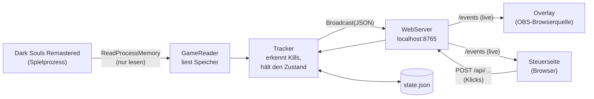

🇩🇪 **Deutsch** | 🇬🇧 [English](CODE.en.md)

# Der Code erklärt

Dieses Dokument geht den DSR Tracker Teil für Teil durch: was jede Datei macht, wie die Teile zusammenspielen und warum etwas so gelöst ist. Es richtet sich an alle, die den Code prüfen, verstehen oder ändern wollen. Programmierkenntnisse helfen, sind aber nicht für jeden Abschnitt nötig.

Die Quelltexte selbst sind ebenfalls ausführlich kommentiert. Dieses Dokument gibt den Überblick, die Kommentare die Details an Ort und Stelle.

**Inhalt**

1. [Das große Bild](#1-das-große-bild)
2. [Dateien im Überblick](#2-dateien-im-überblick)
3. [Program.cs – Startpunkt](#3-programcs--startpunkt)
4. [GameReader.cs – Zugriff auf das Spiel](#4-gamereadercs--zugriff-auf-das-spiel)
5. [Tracker.cs – Kill-Erkennung und Zustand](#5-trackercs--kill-erkennung-und-zustand)
6. [WebServer.cs – lokaler Webserver](#6-webservercs--lokaler-webserver)
7. [Nachrichten zwischen Tracker und Seiten](#7-nachrichten-zwischen-tracker-und-seiten)
8. [dsr_enemies.json – die Gegnerliste](#8-dsr_enemiesjson--die-gegnerliste)
9. [overlay.html – das OBS-Overlay](#9-overlayhtml--das-obs-overlay)
10. [control.html – die Steuerseite](#10-controlhtml--die-steuerseite)
11. [setup.html – der Einrichtungsassistent](#11-setuphtml--der-einrichtungsassistent)
12. [Hilfsdateien: Batch-Skripte, Guide, Schriften](#12-hilfsdateien-batch-skripte-guide-schriften)
13. [GitHub: Workflows und Sicherheit](#13-github-workflows-und-sicherheit)
14. [Typische Änderungen – wo anfassen?](#14-typische-änderungen--wo-anfassen)
15. [Web-Version ohne exe](#15-web-version-ohne-exe)

---

## 1. Das große Bild



In Worten:

1. **GameReader** öffnet das Spiel nur zum Lesen und liest alle 0,5 Sekunden die *Event-Flags*. Das ist ein großer Speicherblock, in dem das Spiel für tausende Dinge ein Bit setzt, zum Beispiel „Boss X besiegt“ oder „Tür Y geöffnet“. Außerdem liest er die Spielzeit und die Spielerposition.
2. **Tracker** vergleicht die Flags mit der Gegnerliste. Ist bei einem Gegner ein Flag neu gesetzt, ist er besiegt. Der Tracker verwaltet dazu manuelle Haken und speichert sie in `state.json`.
3. Bei jeder Änderung schickt der Tracker den kompletten Zustand als JSON an den **WebServer**. Der reicht ihn sofort an alle offenen Seiten weiter, also an Overlay und Steuerseite.
4. Die **Seiten** zeichnen sich daraus neu. Klicks auf der Steuerseite gehen als POST-Anfrage zurück an den Webserver und von dort an den Tracker.

Alles läuft auf dem eigenen Rechner. Es gibt keine Verbindung ins Internet.

---

## 2. Dateien im Überblick

| Datei | Zweck |
|---|---|
| `Program.cs` | Startpunkt: Optionen, Datenordner, Gegnerliste laden, alles starten |
| `GameReader.cs` | Spiel finden, Speicher lesen, Signaturen suchen, Flag-Nummern umrechnen |
| `Tracker.cs` | Datenklassen der Gegnerliste, Kill-Erkennung, Zustand, `state.json` |
| `WebServer.cs` | lokaler HTTP-Server mit Sicherheitsprüfungen, Live-Datenstrom |
| `DSRTracker.csproj` | Projektdatei: Version, welche Dateien in die exe eingebaut werden |
| `dsr_enemies.json` | Gegnerliste: Gebiete, Gegner, Punkte, Flags, Route, Zonenkarte |
| `web/overlay.html` | das Overlay für OBS, alle Ansichten in einer Datei |
| `web/control.html` | Steuerseite: Liste, Overlay-Einstellungen, Splits, Flag-Monitor |
| `web/setup.html` | Einrichtungsassistent beim ersten Start |
| `web/fonts/` | mitgelieferte Schriften (SIL Open Font License) und `fonts.css` |
| `guide.html` | DLDU-Guide (Route, Tipps), läuft auch ohne Tracker |
| `build.bat` | baut `dist\DSRTracker.exe` |
| `update.bat` | lädt die neueste geprüfte exe von GitHub |
| `start_mit_web_ordner.bat` | startet den Tracker mit den HTML-Dateien aus `web\` statt aus der exe |
| `guide.bat` | öffnet den Guide im Browser |
| `.github/workflows/*.yml` | automatische Prüfungen und Release-Build auf GitHub |

Die HTML-Seiten, die Schriften, die Gegnerliste und der Guide werden **in die exe eingebaut** (`EmbeddedResource` in der `.csproj`). Die exe ist dadurch eine einzelne Datei und braucht nichts daneben.

---

## 3. Program.cs – Startpunkt

`Program.cs` hat keine `Main`-Methode, sondern nutzt *Top-Level-Statements*: Der Code läuft von oben nach unten.

1. **Startoptionen** auswerten:

   | Option | Wirkung |
   |---|---|
   | `--port 8766` | anderer Port (nur 1024–65535) |
   | `--no-browser` | Browser nicht automatisch öffnen |
   | `--portable` | Daten neben der exe statt in `%APPDATA%\DSRTracker` |
   | `--web <ordner>` | HTML-Seiten aus einem Ordner laden, zum Anpassen ohne Neu-Bauen |
   | `--selftest` | Flag-Umrechnung prüfen und beenden |

2. **Datenordner** festlegen und anlegen. Ein alter `state.json` neben der exe aus früheren Versionen wird einmalig übernommen.
3. **Gegnerliste** laden. Standard ist die eingebaute Liste. Liegt eine eigene `dsr_enemies.json` im Datenordner und besteht sie die Prüfung (`EnemyFile.Parse`), wird diese verwendet, sonst gibt es eine Warnung.
4. **Selbsttest** (nur mit `--selftest`): Jede Flag-ID wird in eine Speicherposition umgerechnet und wieder zurück. Kommt nicht dieselbe ID heraus, ist etwas falsch. Der Test läuft auch automatisch auf GitHub.
5. **Tracker und Webserver** starten. Ist der Port belegt, etwa weil der Tracker schon läuft, gibt es eine verständliche Meldung.
6. **Konsole**: Version, Anzahl Gegner und Punkte, alle Adressen. Danach öffnet sich der Browser: beim ersten Start der Assistent, später die Steuerseite.
7. **Hauptschleife** `tracker.Run()` läuft, bis das Fenster geschlossen oder Strg+C gedrückt wird.

---

## 4. GameReader.cs – Zugriff auf das Spiel

Dies ist die einzige Datei, die mit dem Spiel spricht, und die wichtigste für eine Sicherheitsprüfung.

### Verbinden (`EnsureAttached`)

Wird bei jedem Durchlauf aufgerufen, sucht aber höchstens alle 2 Sekunden:

1. Prozess `DarkSoulsRemastered` suchen.
2. Prüfen, dass der Dateiname wirklich `DarkSoulsRemastered.exe` ist.
3. **Version erkennen:** SHA256-Prüfsumme der exe-Datei berechnen und mit bekannten Builds vergleichen. Die Dateiversion der DSR-exe ist immer „1.0.0.0“ und hilft nicht. Das Ergebnis wird zwischengespeichert, denn die Datei ist rund 50 MB groß.
4. **Prozess öffnen** mit genau zwei Rechten: `PROCESS_VM_READ` (Speicher lesen) und `PROCESS_QUERY_LIMITED_INFORMATION`. Ein Schreibrecht wird nie angefordert.
5. **Signaturen suchen** (siehe unten). Direkt nach dem Spielstart kann das noch scheitern, dann wird es erneut versucht. Bleibt es nach 15 Versuchen erfolglos, weist der Status auf eine vermutlich nicht unterstützte Spielversion hin.

### Signaturen (AOB-Scan)

Die Spieldaten liegen bei jedem Start an anderen Adressen. Fest ist nur der **Programmcode** des Spiels. Darin gibt es Befehle wie

```
48 8B 0D xx xx xx xx    mov rcx, [rip + xxxxxxxx]
```

die einen globalen Zeiger laden. Der Tracker liest den Programmcode einmal ein (`ReadModuleImage`), sucht das Byte-Muster (`FindPattern`, `?` = beliebiges Byte) und rechnet aus dem Abstand `xxxxxxxx` die Adresse des globalen Zeigers aus (`ScanRelative`):

```
Zieladresse = Adresse des Befehls + Länge des Befehls (7) + Abstand
```

Es gibt drei Signaturen:

| Name | wofür |
|---|---|
| `EventFlags` | Event-Flags, also wer besiegt ist (Pflicht) |
| `WorldChrMan` | Figuren in der Welt: Charakter geladen? Position? (Pflicht) |
| `GameDataMan` | Spielzeit (optional) |

Die Muster und Abstände stammen aus öffentlicher Community-Forschung (DSR-Gadget, SoulMemory).

### Zeigerketten

Von einem globalen Zeiger geht es über feste Abstände weiter, zum Beispiel für die Position:

```
WorldChrMan → +0x68 PlayerIns → +0x68 Steuerung → +0x28 Positionsobjekt → +0x10 X, Y, Z (je 4 Byte float)
```

Ist unterwegs ein Zeiger 0, ist das Objekt gerade nicht da (Hauptmenü, Ladebildschirm). Dann gibt die Funktion `null` zurück.

| Funktion | liest |
|---|---|
| `IsPlayerLoaded()` | ob `PlayerIns` existiert |
| `ReadPlayerPosition()` | X, Y, Z |
| `ReadIgtMs()` | Spielzeit in ms (GameDataMan + 0xA4) |
| `ReadFlagBlock()` | den ganzen Flag-Block, rund 91 KB |

### Event-Flags (`EventFlags`)

Eine Flag-ID hat 8 Ziffern: **G AAA S NNN**

| Teil | Bedeutung | Umrechnung |
|---|---|---|
| G | Gruppe (0, 1, 5, 6, 7) | Startposition der Gruppe im Block |
| AAA | Gebietscode (000, 100, 101 …) | Index in der Gebietsliste × 0x500 Bytes |
| S | Abschnitt 0–9 | × 128 Bytes |
| NNN | Nummer 0–999 | (NNN / 32) × 4 Bytes, Bit NNN % 32 |

**Beispiel: Taurus-Dämon, Flag 11010901**

| | Wert | Bytes |
|---|---|---|
| Gruppe 1 | Start | 0x500 |
| Gebiet 101 | Index 2 → 2 × 0x500 | 0xA00 |
| Abschnitt 0 | 0 × 128 | 0 |
| Nummer 901 | 901 / 32 = 28 → 28 × 4 | 0x70 |
| **Position** | | **0xF70** |
| Bit | 901 % 32 = 5 → Maske `0x80000000 >> 5` | `0x04000000` |

Der Tracker liest also das 4-Byte-Wort an Position 0xF70 im Flag-Block und prüft, ob dort Bit `0x04000000` gesetzt ist.

`FromPosition` macht das Ganze rückwärts (Position + Bit → Flag-ID). Das braucht der Flag-Monitor, um geänderte Bits als lesbare Nummer anzuzeigen.

### Was hier bewusst fehlt

Kein `WriteProcessMemory`, kein `VirtualAllocEx`, kein `CreateRemoteThread`, keine DLL. Aus `kernel32.dll` werden genau drei Funktionen importiert: `OpenProcess`, `ReadProcessMemory` und `CloseHandle`.

---

## 5. Tracker.cs – Kill-Erkennung und Zustand

### Datenklassen

| Klasse | Inhalt |
|---|---|
| `EnemyDef` | ein Gegner: Namen DE/EN, Punkte, Flags, Tipp |
| `AreaDef` | ein Gebiet mit Gegnern |
| `RouteDef` | ein Kapitel der Route: Titel + Gegner-Schlüssel in Spielreihenfolge |
| `EnemyFile` | die ganze Liste + `Parse()` zur Prüfung |
| `RecentKill` | ein Eintrag „letzte Kills“: Name, Punkte, Uhrzeit, Spielzeit |
| `SavedState` | Inhalt von `state.json` |

**Schlüssel** eines Gegners ist `"Gebietsindex-Gegnerindex"`, zum Beispiel `"0-0"` für den ersten Gegner im ersten Gebiet. Dieselben Schlüssel benutzen Steuerseite und Overlay.

**`EnemyFile.Parse`** prüft eine Liste, bevor sie benutzt wird:
- Gebiete und Namen sind vorhanden, Namen höchstens 120 Zeichen lang.
- Punkte liegen zwischen 0 und 100.
- Jedes Flag ist umrechenbar.
- Jeder Routen-Schlüssel existiert.
- Zonen-Einträge haben 4 Werte und verweisen auf ein vorhandenes Gebiet.

### Die Schleife (`Run` → `Poll`)

Alle 0,5 Sekunden läuft ein `Poll()`:

1. **Verbinden.** Wenn das nicht klappt, wird alles zurückgesetzt und beim nächsten Mal erneut versucht.
2. **Charakter geladen?** Im Menü oder Ladebildschirm sind die Daten nicht verlässlich, deshalb wird dann nichts ausgewertet.
3. **Spielzeit** lesen und etwa einmal pro Sekunde als `time`-Nachricht senden, mit Position.
4. **Gebiet schätzen:** den nächstgelegenen Punkt der Zonenkarte suchen (`NearestZone`).
5. **Flag-Block lesen.**
6. **Flag-Monitor:** alten und neuen Block Wort für Wort vergleichen. Jedes geänderte Bit wird mit Flag-ID und, falls bekannt, Gegnername protokolliert.
7. **Kills erkennen:** Ein Gegner gilt als besiegt, wenn **mindestens eines** seiner Flags gesetzt ist. Manche Gegner haben mehrere mögliche Flags.
8. **Melden:** neue Kills in die Konsole und als `kill`-Nachricht an die Seiten (Einblendung). Danach den neuen Zustand senden.

### Regeln gegen Fehlalarme

- **Erster Lesevorgang nach dem Laden:** Hier ist alles „neu“. Deshalb gibt es erst ab dem zweiten Lesevorgang Einblendungen (`_hadFirstRead`).
- **Mehr als 3 neue Kills auf einmal** bedeuten fast immer, dass ein anderer Spielstand geladen wurde. Dann gibt es keine Einblendungen (`newKills.Count > 3`).
- **Flag verschwindet**, etwa weil ein anderer Charakter geladen wurde: Der Gegner ist nicht mehr automatisch erledigt, und die Liste der letzten Kills wird angepasst.

### Automatisch und manuell

| | `_autoDone` | `_manualDone` |
|---|---|---|
| Quelle | Flag im Spielstand | Klick auf der Steuerseite |
| gespeichert | nein, kommt immer aus dem Spiel | ja, in `state.json` |
| zurücksetzen | anderen Spielstand laden | „Manuelle Haken zurücksetzen“ |

Ein Gegner zählt als erledigt, wenn er in einer der beiden Mengen ist. 12 Gegner respawnen und haben kein dauerhaftes Flag. Sie gehen nur manuell.

### Zustand (`GetStateJson`)

Der komplette Zustand als JSON, siehe [Abschnitt 7](#7-nachrichten-zwischen-tracker-und-seiten). Er wird bei jeder Änderung an alle Seiten geschickt.

### Gleichzeitigkeit

Die Tracker-Schleife und der Webserver (Klicks) laufen in verschiedenen Threads. Alles, was beide anfassen, wird unter `lock (_lock)` geändert. Nachrichten werden außerhalb des Locks verschickt, damit eine langsame Seite den Tracker nicht aufhält.

---

## 6. WebServer.cs – lokaler Webserver

Basiert auf `HttpListener` aus .NET und lauscht nur auf `http://localhost:8765/`. Dadurch braucht er keine Administratorrechte.

### Adressen

| Methode | Pfad | Wirkung |
|---|---|---|
| GET | `/`, `/control` | Steuerseite |
| GET | `/setup` | Einrichtungsassistent |
| GET | `/guide` | Guide |
| GET | `/overlay` | Overlay (Optionen in der URL) |
| GET | `/fonts/…`, `/web/fonts/…` | Schriften, nur Namen wie `name.woff2/.css/.txt` |
| GET | `/events` | Live-Datenstrom (Server-Sent Events) |
| GET | `/api/state` | Zustand einmalig als JSON |
| POST | `/api/toggle?key=0-0` | manuellen Haken umschalten |
| POST | `/api/area?idx=3` | Gebiet fest einstellen (-2 = automatisch) |
| POST | `/api/reset` | manuelle Haken zurücksetzen |
| POST | `/api/clearlog` | Flag-Monitor leeren |
| POST | `/api/test-toast` | Test-Einblendung |
| POST | `/api/onboarding-done?done=1` | Assistent abgeschlossen |
| GET | `/favicon.ico` | leere Antwort (204), damit der Browser nicht meckert |

Alles andere ergibt 404. Dateinamen kommen **nie** aus der Anfrage, sondern stehen fest im Code. Pfad-Tricks wie `../` sind damit ausgeschlossen.

### Sicherheitsprüfungen (bei jeder Anfrage)

1. **Nur vom eigenen Rechner:** Die Absenderadresse muss eine Loopback-Adresse sein.
2. **Host-Header** muss `localhost`, `127.0.0.1` oder `[::1]` mit unserem Port sein. Das schützt gegen *DNS-Rebinding*: Eine fremde Webseite lässt ihre Domain plötzlich auf 127.0.0.1 zeigen und könnte sonst den Tracker abfragen.
3. **POST nur von den eigenen Seiten:** Ein fremder `Origin` oder `Sec-Fetch-Site: cross-site` wird abgewiesen. Das schützt gegen *CSRF*: Eine fremde Webseite schickt im Hintergrund Klicks an localhost.

Dazu kommen Sicherheits-Header auf allen Antworten (`AddSecurityHeaders`):
- `Content-Security-Policy`: Skripte, Styles, Schriften und Verbindungen nur vom eigenen Server; einbetten nur durch eigene Seiten.
- `X-Content-Type-Options: nosniff`
- `Referrer-Policy: no-referrer`

### Live-Datenstrom (`/events`)

*Server-Sent Events* sind eine dauerhaft offene HTTP-Antwort, in die der Server immer wieder Zeilen schreibt:

```
retry: 2000

data: {"type":"state", …}

data: {"type":"kill","key":"0-0","de":"Asyl-Dämon","en":"Asylum Demon","pts":5}
```

- `retry: 2000`: Bricht die Verbindung ab, verbindet sich der Browser nach 2 Sekunden selbst neu.
- Direkt nach dem Verbinden kommt der aktuelle Zustand.
- Alle 15 Sekunden kommt eine Kommentarzeile `: ping`. Sie hält die Verbindung offen und räumt geschlossene Seiten aus der Liste.

---

## 7. Nachrichten zwischen Tracker und Seiten

Drei Arten von Nachrichten kommen über `/events`:

**`state`** – der komplette Zustand, bei jeder Änderung:

| Feld | Bedeutung |
|---|---|
| `connected`, `playerLoaded`, `status`, `gameVersion` | Verbindung zum Spiel |
| `total`, `maxTotal`, `done`, `count` | Punkte und Anzahl Gegner gesamt |
| `areas[]` | Gebiete mit `de`, `en`, `done`, `count`, `pts`, `maxPts`, `enemies[]` |
| `areas[].enemies[]` | `key`, `de`, `en`, `pts`, `done`, `auto`, `manual`, `tip`, `tracked` (hat Flags) |
| `igt` | Spielzeit in ms (oder `null`) |
| `currentArea`, `areaAuto`, `autoArea`, `pos` | Gebiet (-2 unbekannt, -1 Feuerband-Schrein) und Position |
| `route[]` | Kapitel: `title`, `titleEn`, `keys[]` |
| `recentKills[]` | letzte Kills, neueste zuerst |
| `flagLog[]` | Flag-Monitor (höchstens 60 Einträge) |
| `onboardingDone` | Assistent abgeschlossen? |

**`time`** – etwa jede Sekunde: `igt` und `pos`. Die Seiten aktualisieren dann nur die Zeitanzeige.

**`kill`** – ein neuer Kill: `key`, `de`, `en`, `pts`. Löst die Einblendung aus. Bei `key = "test"` ist es die Test-Einblendung aus dem Assistenten.

---

## 8. dsr_enemies.json – die Gegnerliste

```json
{
  "areas": [
    { "de": "Nördliches Asyl der Untoten", "en": "Northern Undead Asylum",
      "enemies": [
        { "de": "Asyl-Dämon", "en": "Asylum Demon", "pts": 5, "flags": [16], "tip": "…" }
      ] }
  ],
  "route": [
    { "title": "2 · Stadt der Untoten", "titleEn": "2 · Undead Burg", "keys": ["1-0", "1-1", "1-3", "1-2"] }
  ],
  "zones": [ [275.1, -3.5, -99.5, 3], … ]
}
```

| Teil | Inhalt |
|---|---|
| `areas` | 26 Gebiete, 84 Gegner. `flags` leer = nur manuell (respawnt). `manual: true` markiert diese Fälle zur Dokumentation. |
| `route` | 15 Kapitel in Spielreihenfolge, aus dem Guide. Grundlage für „Nach Route“, „Nächstes Ziel“, Lückenbalken und ausgelassene Gegner. |
| `zones` | rund 2.100 Punkte `[x, y, z, Gebietsindex]`. Das Gebiet ist das des nächstgelegenen Punkts; -1 = Feuerband-Schrein. |

Die Namen stammen aus den deutschen und englischen Spieltexten, die Punkte aus den DLDU-Regeln.

---

## 9. overlay.html – das OBS-Overlay

Eine einzige Seite für alle Ansichten. Welche Ansicht und welche Optionen, steht in der URL, zum Beispiel `/overlay?view=rotate&lang=en&theme=mond`.

### Aufbau

1. **`<style>`**: Farben als CSS-Variablen (`--gold`, `--panel` …). Die Farbschemata überschreiben nur diese Variablen (`:root[data-theme="mond"]`). Danach folgt je Ansicht ein Abschnitt.
2. **Optionen** (`opt`): aus der URL gelesen, mit Standardwerten.
3. **Hilfsfunktionen**: Gruppierung, Namen, Balken, Zeit.
4. **Ansichten**: je eine `render…`-Funktion, die das komplette HTML neu aufbaut.
5. **Verbindung** (`connect`): `state` → neu zeichnen, `time` → nur Zeit, `kill` → Einblendung.

### Ansichten

| `view=` | Funktion | Inhalt |
|---|---|---|
| `full` (Standard) | `renderFull` | alle Gebiete in Spalten |
| `compact` | `renderCompact` | Punkte, Balken, letzte Kills |
| `next` | `renderNext` | nächste offene Gegner der Route |
| `area` | `renderArea` | nur das aktuelle Gebiet |
| `ticker` | `renderTicker` | schmales Laufband |
| `rotate` | `renderRotate` | Wechselnde Gebiete |

### Wichtige Optionen

| Option | Wirkung |
|---|---|
| `order=route` | nach Route-Kapiteln statt nach Gebiet |
| `lang=de/en/both` | Sprache der Namen |
| `theme=glut/mond/abgrund` | Farbschema |
| `scale=1.5` | Größe |
| `bar=gaps` | Balken mit einem Stück pro Gegner in Routen-Reihenfolge |
| `hideDone=1`, `hideCleared=1`, `collapseCleared=1` | Erledigtes ausblenden oder einklappen |
| `missed=0` | ausgelassene Gegner nicht rot markieren |
| `toast=0`, `toastPos=bottom-left` | Einblendung aus oder an andere Stelle |
| `time=0`, `total=0` | Zeit- bzw. Gesamtzeile aus |
| `interval`, `hold`, `merge`, `timer`, `shade`, `title` | nur für `rotate`, siehe unten |

Die vollständige Liste steht kommentiert am Anfang des Skripts. Die Steuerseite baut die URL per Klick zusammen.

### Einzelne Mechaniken

**Gruppierung (`groups`)**: Nach Gebiet werden die Daten direkt verwendet. Nach Route werden die Kapitel aus `route` gebaut, jeder Gegner bekommt zusätzlich seinen Gebietsnamen.

**Ausgelassene Gegner (`missedSet`)**: Alle Gegner in Routen-Reihenfolge durchgehen und den zuletzt besiegten suchen. Jeder offene Gegner davor gilt als ausgelassen und wird rot markiert. Das Ergebnis wird pro Zustand zwischengespeichert.

**Lückenbalken (`barInner` mit `bar=gaps`)**: Jeder Gegner ist ein Stück, so breit wie seine Punkte. Erledigte Stücke werden gefüllt, ausgelassene rot. Der Farbverlauf läuft vom Anfang bis zum zuletzt erledigten Stück, damit er wie beim normalen Füllstand aussieht.

**Wechselnde Gebiete (`rotate`)**:
- `rotPages` teilt die Gebiete in Seiten auf. Mit `merge` teilen sich kleine Gebiete mit höchstens 3 Gegnern eine Seite (höchstens 6 Zeilen), aber nur, wenn sie in der Liste direkt aufeinander folgen **und** in der Route direkt nacheinander drankommen (`runContiguous`).
- Alle `interval` Sekunden geht es eine Seite weiter (`rotStart`).
- Nach einem Kill springt die Rotation zur Seite des Gegners und bleibt `hold` Sekunden stehen (`rotJumpTo`). Danach geht es mit der folgenden Seite weiter.
- `timer` zeigt einen Ablaufbalken, `shade` einen dunklen Schleier hinter dem Text für Kontrast auf hellem Spielbild.

**Einblendung (`toast`)**: „+5 Asylum Demon“ in der gewählten Ecke, verschwindet nach gut 5 Sekunden. Der Gegner leuchtet zusätzlich kurz auf (`flashKeys`).

**Sicherheit im Browser**: Namen werden vor dem Einsetzen ins HTML mit `esc()` maskiert, weil sie aus einer eigenen Gegnerliste stammen könnten.

---

## 10. control.html – die Steuerseite

| Bereich | Inhalt |
|---|---|
| Kopfzeile | Status mit farbigem Punkt (grün = verbunden + Charakter, gelb = Menü, rot = kein Spiel), Spielversion, Punktestand |
| linke Spalte | alle Gegner. Klick = manuell umschalten. Automatisch erkannte sind gesperrt, weil der Haken aus dem Spielstand kommt. |
| OBS-Overlay | Ansicht und Optionen wählen → fertige URL, Vorschau, empfohlene Größe |
| Run | Zähler auto/manuell, manuelle Haken zurücksetzen |
| Aktuelles Gebiet | Anzeige und fest einstellen |
| Splits | Kills mit Spielzeit und laufender Summe |
| Flag-Monitor | zuletzt geänderte Flags, bekannte gold markiert |

Einzelheiten:
- **Nur passende Optionen anzeigen:** Jedes Optionsfeld trägt `data-v="…"` mit den Ansichten, für die es wirkt. `showRelevant()` blendet den Rest aus.
- **Kurze URLs:** `overlayUrl()` übernimmt nur Werte, die vom Standard abweichen und für die gewählte Ansicht gelten.
- **Einstellungen merken:** Die Overlay-Einstellungen und die Sortierung werden im `localStorage` des Browsers gespeichert, nicht im Tracker.

---

## 11. setup.html – der Einrichtungsassistent

Fünf Schritte, jeder ist eine Funktion, die das HTML des Schritts liefert:

| Schritt | Funktion | Inhalt |
|---|---|---|
| 1 | `pageWelcome` | Überblick, Easy Setup „Bin überfordert, mach einfach!“ |
| 2 | `pageConnect` | Live-Prüfung: Tracker → Spiel → Charakter |
| 3 | `pageOverlay` | Ansichten (mehrere möglich) und Farbschema wählen |
| 4 | `pageObs` | je Ansicht URL, Größe und maßstabsgetreue Vorschau, Test-Einblendung |
| 5 | `pageDone` | Zusammenfassung, „nicht mehr anzeigen“ |

- **Easy Setup:** wählt „Wechselnde Gebiete“ (Lückenbalken, fertige Gebiete ausblenden, Englisch) und „Nächstes Ziel“ (zwei Ziele, ohne Tipp) und springt direkt zu Schritt 4.
- **Mehrere Quellen:** Nur die erste Ansicht zeigt Einblendungen, die weiteren bekommen `toast=0`, sonst erschiene jede Einblendung doppelt.
- **Vorschauen** (`fitPreviews`): Das Overlay wird in echter OBS-Größe gezeichnet und dann verkleinert, damit es genauso aussieht wie später in OBS.
- **Abschluss:** `POST /api/onboarding-done` → der nächste Start öffnet direkt die Steuerseite.

---

## 12. Hilfsdateien: Batch-Skripte, Guide, Schriften

**`build.bat`** prüft, ob das .NET SDK installiert ist, und baut dann mit `dotnet publish` eine eigenständige Einzeldatei:
- `-r win-x64`: für 64-Bit-Windows
- `--self-contained`: Die .NET-Laufzeit steckt in der exe.
- `PublishSingleFile`, `EnableCompressionInSingleFile`: eine einzige, komprimierte Datei

**`update.bat`** ist gleichzeitig ein Batch- und ein PowerShell-Skript:
- **Trick:** Die erste Zeile `<# :` ist für cmd ein harmloses Sprungziel, für PowerShell der Beginn eines Kommentarblocks bis `#>`. cmd führt nur den oberen Teil aus, und der übergibt die Datei an PowerShell. Dadurch reicht ein Doppelklick, ohne dass man die Ausführungsrichtlinie ändern muss.
- **Schritte:** neueste Version bei GitHub abfragen → in einen Temp-Ordner laden → SHA256 gegen die `.sha256`-Datei **und** gegen die Angabe von GitHub prüfen → Herkunftsnachweis mit `gh attestation verify` prüfen, falls die GitHub CLI installiert ist → abbrechen, wenn der Tracker läuft → alte exe als `.bak` sichern und ersetzen.
- Bei jedem Fehler bricht das Skript ab, ohne etwas zu verändern. Ist die exe schon aktuell, passiert nichts; `--force` lädt sie trotzdem neu.

**`start_mit_web_ordner.bat`** startet `dist\DSRTracker.exe --web web`. Änderungen an den HTML-Dateien wirken dann sofort, ein Neuladen der Seite genügt.

**`guide.html` / `guide.bat`**: Der DLDU-Guide ist eine eigenständige Seite. Er läuft im Browser auch ohne Tracker und wird zusätzlich vom Tracker unter `/guide` ausgeliefert.

**`web/fonts/`**: Cinzel, Alegreya, Alegreya Sans und Cormorant Garamond als `.woff2` (aus `@fontsource`, SIL Open Font License, Lizenztexte liegen bei). So lädt keine Seite etwas von Google Fonts oder anderen Servern.

---

## 13. GitHub: Workflows und Sicherheit

| Datei | wann | was |
|---|---|---|
| `build.yml` | jeder Push/PR | bauen mit `-warnaserror`, Selbsttest, verwundbare Pakete prüfen |
| `codeql.yml` | jeder Push/PR + montags | statische Sicherheitsanalyse für C# und JavaScript |
| `release.yml` | Release veröffentlicht | Selbsttest, exe bauen, SHA256, Herkunftsnachweis signieren, exe + Prüfsumme + `update.bat` an den Release hängen |
| `dependabot.yml` | monatlich | Pull Requests für neue Versionen der GitHub Actions |

Der **Herkunftsnachweis** (Build-Provenance) wird von GitHub signiert. Er belegt, dass genau diese exe von `release.yml` aus genau diesem Commit gebaut wurde. Prüfen lässt er sich mit `gh attestation verify DSRTracker.exe --repo spidy666/DSRtracker`. Details stehen in der README unter „Download und Prüfung“.

---

## 14. Typische Änderungen – wo anfassen?

| Vorhaben | Datei(en) |
|---|---|
| Gegner, Punkte, Namen oder Route ändern | `dsr_enemies.json`, danach `--selftest` laufen lassen |
| neue Spielversion unterstützen | `GameReader.cs`: SHA256 in `KnownBuilds` eintragen; falls sich die Speicherstruktur geändert hat, Signaturen anpassen |
| neue Overlay-Option | `overlay.html` (`opt` + Verwendung), `control.html` (Feld mit `data-v`, `fields`, `overlayUrl`) |
| neue Overlay-Ansicht | `overlay.html` (`render…` + Eintrag in `render()` + CSS), `control.html` (Auswahl, `SIZES`), `setup.html` (`VIEWS`) |
| neues Farbschema | `overlay.html` (`:root[data-theme="…"]`), Auswahl in `control.html` und `setup.html` |
| neue Aktion auf der Steuerseite | `control.html` (Knopf + `fetch("/api/…", {method:"POST"})`), `WebServer.cs` (`case`), `Tracker.cs` (Methode) |
| Version erhöhen | `DSRTracker.csproj` (`<Version>`), `CHANGELOG.md` und `CHANGELOG.en.md` |
| Dokumentation ändern | immer die deutsche Datei und die `.en.md`-Datei anpassen |

**Zum Ausprobieren ohne Neu-Bauen:** Den Tracker mit `start_mit_web_ordner.bat` starten, HTML-Dateien in `web\` ändern und die Seite neu laden. In OBS: Rechtsklick auf die Quelle → „Aktualisieren“.

---

## 15. Web-Version ohne exe

Die Web-Version benutzt **dieselben Seiten** (`web/control.html`, `web/overlay.html`). Statt der exe beantwortet ein kleines Skript im Browser die Anfragen. Einrichtung und Hosting stehen in [WEBVERSION.md](WEBVERSION.md).

| Datei | Zweck |
|---|---|
| `pages/local-backend.js` | ersetzt im Browser den Tracker-Server |
| `pages/control-web.js` | passt die Steuerseite an (Run-Uhr, Sichern/Laden, Exe-Teile ausblenden) |
| `pages/index.html` | Startseite mit Anleitung für OBS |
| `pages/obs-test.html` | Test, ob OBS-Dock und Browserquelle denselben Speicher teilen |
| `tools/build_pages.py` | baut aus `web/` + `pages/` einen Ordner mit statischen Dateien |
| `.github/workflows/pages.yml` | baut bei Pull Requests, veröffentlicht bei `main` auf GitHub Pages |

### Wie `local-backend.js` die exe ersetzt

Das Skript wird vor allen anderen Skripten geladen und ersetzt zwei Browser-Funktionen:

- **`EventSource`** (für `/events`): Statt einer Verbindung zur exe liefert es Nachrichten aus dem Browser selbst. Sie haben dasselbe Format wie in [Abschnitt 7](#7-nachrichten-zwischen-tracker-und-seiten) (`state`, `time`, `kill`). Overlay und Steuerseite merken davon nichts.
- **`fetch`** für Adressen mit `/api/…`: wird lokal ausgeführt, etwa `toggle`, `reset`, `area`, `test-toast` und neu `clock` für die Run-Uhr. Alle anderen Anfragen gehen normal ins Netz, das ist nur das Laden von `dsr_enemies.json`.

Der **Zustand** liegt im `localStorage` unter `dsr-web-state-v1`: abgehakte Gegner, letzte Kills, Gebiet und Uhr. `buildState()` baut daraus dasselbe JSON wie `Tracker.GetStateJson()`, nur ohne Spiel: `connected = false`, kein Flag-Monitor, `auto` immer `false`.

**Abgleich zwischen Dock und Overlays** auf drei Wegen, damit es möglichst in jeder Umgebung klappt:

1. `storage`-Ereignis: Der Browser meldet anderen Fenstern derselben Adresse Änderungen am `localStorage`.
2. `BroadcastChannel("dsr-web")`: direkte Nachricht zwischen Fenstern.
3. Sicherheitsnetz: alle 0,7 Sekunden selbst nachsehen, ob sich der Stand geändert hat.

**Kill-Meldungen** stehen zusätzlich unter `dsr-web-event-v1`. Jede trägt eine eindeutige Nummer. Ein Fenster zeigt nur Meldungen, die es noch nicht kennt und die jünger als 10 Sekunden sind. So gibt es keine doppelten oder veralteten Einblendungen.

**Run-Uhr:** gespeichert als bisher gelaufene Zeit (`acc`) plus Startzeitpunkt (`runningSince`), solange sie läuft. Daraus ergibt sich jederzeit die aktuelle Zeit, auch nach einem Neuladen. Läuft sie, wird jede Sekunde eine `time`-Nachricht verschickt.

### `control-web.js`

Läuft nach dem Skript der Steuerseite und verändert nur die Oberfläche:

- Links „Einrichtung“ und „Guide“ zeigen auf die Startseite bzw. den Guide der Web-Version.
- Exe-Teile werden ausgeblendet: Flag-Monitor, Positionsanzeige, die Markierungen „auto“ und „nur manuell“.
- Neue Karten:
  - **Run-Uhr** mit Start, Pause und „auf 0“.
  - **Stand sichern** als JSON-Datei. Beim Laden wird die Datei geprüft (Größe, Version, Schlüsselformat), und nur bekannte Felder werden übernommen.

### `build_pages.py`

1. Kopiert `pages/*`, die Schriften und `dsr_enemies.json` in den Zielordner.
2. Kopiert `control.html`, `overlay.html` und `guide.html` und ersetzt dabei:
   - absolute Pfade (`/fonts/…`, `/setup`, `/guide`) durch relative, damit die Seite auch in einem Unterordner wie `…/DSRtracker/` läuft
   - die Overlay-URL in der Steuerseite (`/overlay` → `overlay.html`)
   - fügt `local-backend.js` im Kopf und `control-web.js` am Ende ein
3. Findet das Skript eine Stelle nicht, bricht es mit einer Meldung ab. So fällt es sofort auf, wenn sich eine Seite geändert hat, statt dass eine halb funktionierende Web-Version entsteht. Der Workflow `pages.yml` baut deshalb auch bei jedem Pull Request.

